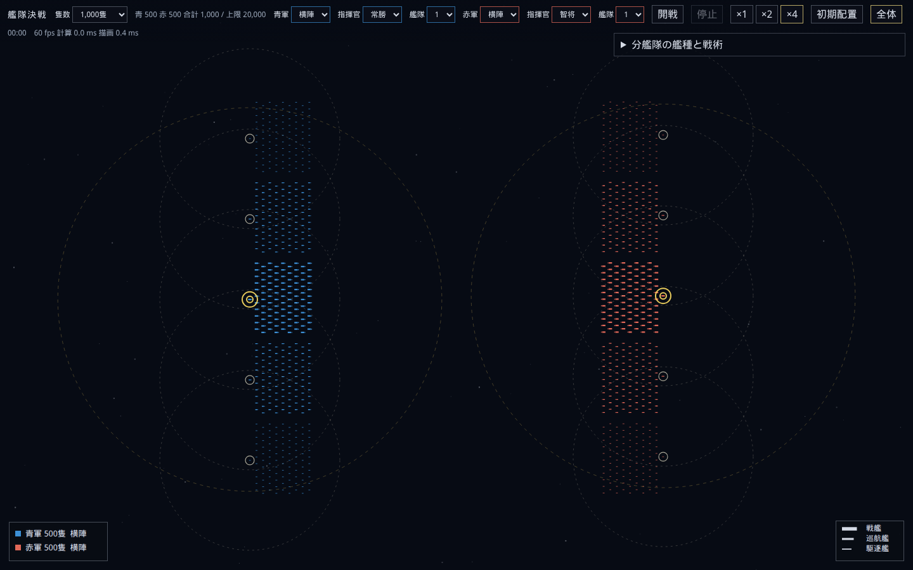
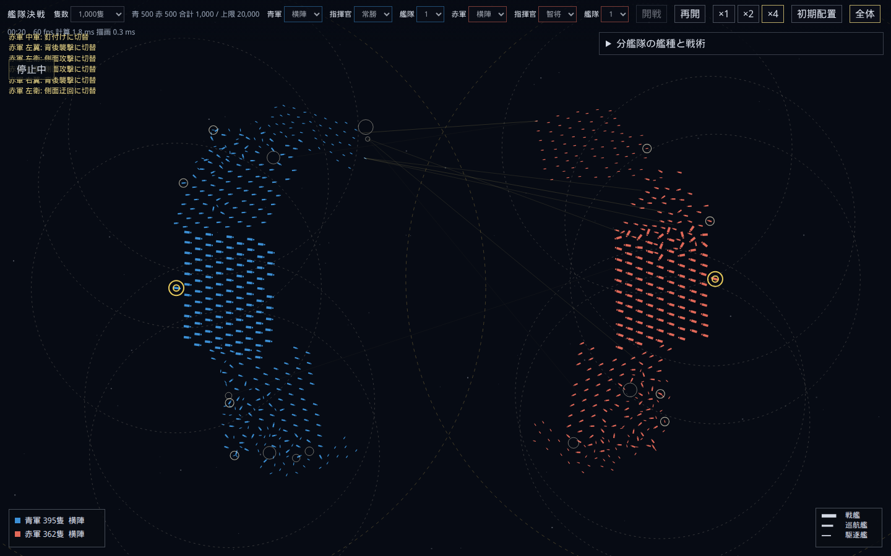
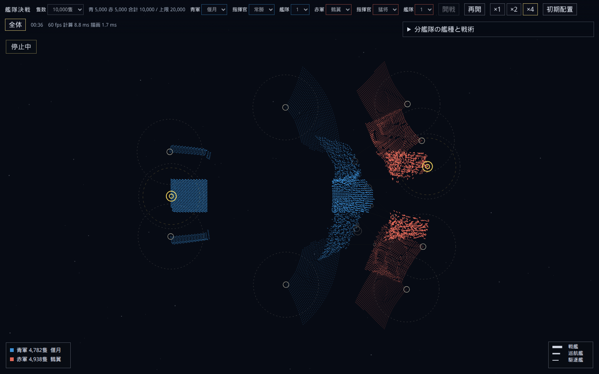
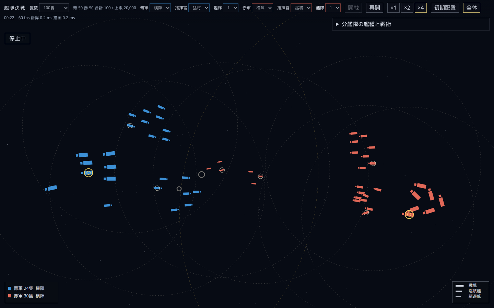

# 戦術の美しさ 第1回

学習は止めたままです。この文書は、今の戦いを見て、次にどの方向へ触るかを選ぶための提案です。コードは変えていません。

見たいのは、多くの艦が戦列を組み、揃って敵を叩く絵です。銀河英雄伝説のように、陣が読めて、動きに意味がある戦いです。

## 今の動きを一言で

艦は五つの隊に分かれ、隊ごとに戦術の名前が付きます。正面突撃、側面迂回、背後襲撃、釘付け、集中砲火などです。指揮官は数秒ごとに、隊ごとの状況を見て名前を付け替えます。

ただし、片側がおおよそ 400 隻を超えると、その名前は射撃の狙いには残っても、隊の足は別の規則に渡ります。広い艦隊は U 字に寄せ、詰まった艦隊は一つの点に向かって縦に積まれ、崩れた艦隊は縮みます。1,000 隻や 10,000 隻の見た目は、こちらの方が主役です。

100 隻の小さい戦いだけ、隊の名前どおりに足が動きます。猛将同士だと、二つの艦隊が相手の中を通り抜け、向きが大きく回ります。

砲は、届く敵のうち条件の良い艦を各艦が選びます。並んだ列だからよく撃てる、というご褒美はありません。

## 実際に回して見えたこと

ルールの指揮官で、同じ条件を数回ではなく代表の一本ずつ見ました。数字はシミュレーション上の秒です。

### 1,000 隻、横陣対横陣、常勝対智将

開戦の瞬間、両軍は幅 1,074、厚さ 176 の横に長い列です。幅は厚さの 6.1 倍。艦の向きは完全に揃っています。

20 秒後には幅 600、厚さ 182 まで縮み、比は 3.3 です。隊と隊の間隔は 537 から 250 前後まで詰まります。常勝側は四つの隊が側面迂回、一つが集中砲火。智将側は背後襲撃、側面迂回、釘付け、側面攻撃が同時に出ています。一つの戦列ではなく、別々の用事を持った塊です。

40 秒後も列には戻りません。戦闘の終わり近く、智将側は幅と厚さがほぼ同じ塊になります。

### 1,000 隻、鶴翼対鋒矢、猛将対守将

猛将側は、24 秒で艦の向きの揃いが 100 から 39 に落ち、72 秒では 9 です。ほぼばらばらの方向を向いています。守将側は縦に細長い塊のまま、敵の方を向いていない艦が序盤で 6 割を超えます。五つの隊が五種類の戦術を同時に持っています。

### 1,000 隻、方円対偃月、常勝対智将

円だった側は、縦 1,000・幅 500 の細長い列に潰れます。三日月だった側は翼が折れ、幅 1,959 から 619 まで狭まります。二つの艦隊の中心は 1,200 以上離れたまま、混ざり合いは起きません。撃ち合いの線にはならず、片方が削られ、もう片方はほとんど減らない時間帯があります。

### 10,000 隻、横陣対鶴翼、常勝対猛将

開戦時はどちらも横に広い陣です。常勝は幅が厚さの 5.9 倍、猛将は 5.2 倍です。

40 秒後、比は 2.1 と 2.4 まで落ちます。猛将側の艦の向きの揃いは 15 まで落ち、隊の向きの揃いも 13 です。両軍の前後が 15% 入り交じります。画面では、遅れて残った塊、絡まった中央、別方向を向いた翼が同時に見えます。戦列という言葉が当てはまりません。

この画面は、いつもの操作（常勝は学習した指揮官）で開戦したので、陣形は選んだ横陣から偃月と鶴翼に置き換わったあとの絵です。置き換わったあとでも、陣は一つの線にはなりません。

### 100 隻、横陣、猛将対猛将

こちらは隊の名前どおりに動きます。24 秒で両軍の中心の間隔が 26 まで縮み、艦隊が相手の中を通ります。その前後で、相手を見る向きが 150 度以上回ります。残った艦は、小さな群れがそれぞれ別の方を向いた状態です。

### 学習した常勝

1,000 隻の横陣で、学習した常勝は最後まで五つの隊を正面突撃のままにしました。向きはよく揃います。ただし陣の幅は 1,074 から 446 まで縮み、比は 6.1 から 2.3 になります。列を保った戦術ではなく、一塊で押す動きです。相手のルールの智将は、これまでどおり隊ごとに別の戦術へ分かれます。

### まとめると、絵が美しくない理由

- 開戦の列はきれいだが、接触の前に幅が潰れ、厚くなる。
- 隊が別々の用事を持ち、同じ方向を向かなくなる。1 万隻では向きの揃いが 100 から 15 まで落ちる。
- 400 隻を超えると、画面の戦術名と隊の足が一致しない。足は U 字か縦の塊か収縮である。
- 小さい猛将同士は、戦列で撃ち合う前に艦隊がすれ違い、艦が散る。
- 並んでいること自体には、砲の上のご褒美がない。

衝突で沈んだ艦は、これらの戦いではゼロでした。壊れているのは衝突ではなく、陣の読みやすさです。

## 五つの方向

一つを選んでください。選ばれたものを、次の回でさらにいくつかに分けます。いまは混ぜません。

### 1. 戦列を崩さない

開戦の横に長い列を、撃ち合いのあいだも保ちます。隊は列の中を左右にずれてもよいですが、勝手に背後へ回ったり、縦の塊に潰れたりしません。艦の向きは列の向きに従い、各艦がばらばらに首を振りません。

画面では、二つの長い帯が向かい合い、弾の線がそのあいだから出ます。翼が少し前に出ることはあっても、艦隊が雲になったり、1 万隻が三つの塊に裂けたりしません。

変えるのは、大きい艦隊を U 字や縦の塊へ寄せる動きと、隊ごとの自由な回り込みです。艦は自分の標的ではなく、列の向きを見ます。

遊びは、銀英の開幕のように「壁が壁を撃つ」感じになります。深さは、距離を保つか、列のどちらを厚くするか、いつ列を自分から壊すか、に寄ります。個々の艦の勇ましさは減ります。

リスクは、今の智将や猛将の個性が「列の中の役割」に見えなくなり、平坦に感じることです。100 隻の小回りも、列の規則に合わせると静かになります。

大きさは中くらいです。隊の足と、艦がどちらを向くかを変えます。計算は、艦ごとの自由な追尾をやめる分だけ軽くなる見込みです。1 万隻 12ms、6 艦隊 14ms の上限には余裕で収まるはずです。

### 2. 五つの隊が一つの作戦で動く

艦隊に一つだけ作戦を出します。たとえば「中央が敵を正面で押さえ、両翼が同時に側面へ着く」。五つの隊は、その作戦の役割と時刻を共有します。片翼だけが先に着いて、もう片翼が別の敵を追う、ということはしません。砲も、作戦が決めた一つの敵の隊に集まり、そこが崩れてから次へ移ります。

画面では、翼が左右同時に開き、同じタイミングで内側へ回頭するのが目で追えます。弾の線が一つの敵の塊に束になります。今のように、左上の記録が「背後」「側面」「釘付け」と別々の話を並べることは減ります。

変えるのは、隊ごとの戦術の選び方です。状況で五つの名前を別々に決めるのをやめ、艦隊の作戦が五つの道筋をまとめて配ります。400 隻以上で足を奪っている U 字や縦の塊も、この作戦の一部にするか、やめます。

遊びは、「美しい手」が見える戦いです。深さは、どの作戦をいつ出すか、敵の作戦を読んで合わせるかにあります。今の十種類の戦術名は、プレイヤーが読むには多すぎるので、作戦は少数に絞ります。

リスクは、時刻を決めすぎると寸劇になり、状況の変化に遅く見えることです。作戦の種類を増やすと、また今のばらばらさに戻ります。

大きさは中くらいからやや大きいです。艦の一台一台ではなく、艦隊と五つの隊だけを触ります。計算の増加はごく小さいです。上限は問題になりません。

### 3. 戦いを段階に分ける

一つの戦いを、接近、整列、撃ち合い、決断、追撃の五段階にします。接近では列を保って進み、あまり撃ちません。整列では両方が砲の届く距離で一度止まり、横隊を整えます。撃ち合いはその距離を保ったまま続きます。どちらかの列が折れたら決断で、追撃か後退に入ります。

画面では、静かな接近のあと、二つの線が平行になる瞬間があり、そこから弾が帯のように行き交います。いきなり雲になって絡むことはありません。折れた側だけが隊の形を失い、勝っている側は列のまま前へ出ます。

変えるのは、距離と時間で艦隊の段階を進める規則です。段階ごとに、撃てる砲と、許される動きを変えます。今は接触の前後で動きの種類が連続して切り替わるだけで、観客が「いまは撃ち合いだ」と言い切れる区切りがありません。

遊びは、物語として語れる戦いになります。深さは、撃ち合いをいつ捨てて突っ込むかです。早く突っ込めば列が乱れ、遅ければ相手に撃たれ続けます。

リスクは、接近と整列が長く感じられ、待たされているように見えることです。段階を自動で進めると、プレイヤーの手が遅れて見えることもあります。

大きさは中くらいです。新しい段階の規則を一つ足し、移動と射撃がそれを見るようにします。計算はほぼ増えません。

### 4. 並んだ列だけがよく撃てる

砲の規則を変えて、きれいな横隊を報いるようにします。隣の艦が同じ向きで間隔を保っているとき、横の砲が通ります。塊の中では味方の艦が射線を塞ぎ、ほとんど撃てません。相手の艦首がこちらを向いているところへ、こちらの横隊が横切ると、相手は撃てずこちらだけが撃てます。真正面から突っ込むと、当たる砲は少なくなります。

画面では、整った列の側面から弾がシートのように出ます。乱れた雲は暗いままです。片方の線が相手の前に横切った瞬間だけ、弾が一気に増えます。

変えるのは砲です。今は艦首の砲が主役で、各艦が届く敵を個別に選びます。これを、列の向きと、射線上の味方がいるかどうかで強く変えます。動きそのものは次の回まで大きく触らなくてかまいません。ただし、艦首を敵へ向けたまま撃つ今の癖だと、横隊の砲は生きません。列は敵に対して横を向く必要があります。

遊びは、位置の幾何学が勝敗になります。銀英で艦隊が針路を合わせる理由が、画面の中にできます。深さは、いつ横隊を敷き、いつ針路を変えるかです。

リスクは、今の「艦首を敵へ」という見た目と真逆になることです。艦の絵が艦首方向に長いので、横隊は今より説明が要ります。射線の判定を全弾で細かくやると、1 万隻で遅くなる恐れがあります。隊ごとにまとめて判定し、弾のたびに全艦を探さないようにすれば、今の上限内に収まる見込みです。雑に全弾へ足すと、12ms を超えるかもしれません。

大きさは中くらいです。主に砲と、艦がどちらを向くかです。

### 5. 命令が降りてから動き、隊はまとめて折れる

命令は艦隊から隊へ、隊から艦へと、目に見える遅れで伝わります。数秒のあいだ、前の命令のまま動きます。損害を受けた隊や旗艦を失った隊は、ばらばらに迷うのではなく、隊の形を保ったまま動きが鈍くなり、列のその位置だけが遅れます。耐えきれなくなった隊は、一個の塊として列から脱落します。

画面では、命令が列の端まで波のように伝わるのが見えます。傷ついた翼だけが少し後ろへ垂れます。艦は隊の中で同じ方向を向いたままです。1 万隻でも、目が追うのは艦ではなく隊です。

変えるのは、艦が自分の標的を見て首を振る部分と、旗艦を失ったあとのばらけ方です。旗艦を失うと艦首を敵へ向ける今の動きは、隊全体が敵を向いたまま鈍る、にまとめます。隊に「まとまり」の数値を持たせ、それが尽きると隊ごと列を離れます。

遊びは、大きな生き物が一つ動く感じです。深さは、命令のタイミングと、垂れた翼を突くかどうかです。遅れがあるので、出した手を相手が読めます。

リスクは、艦が避けなくなり、隊の形が硬すぎると重なって沈むことです。今回見た戦いでは衝突沈没はゼロだったので、硬くしすぎない調整が要ります。遅れが長いと、プレイヤーは反応が悪いと感じます。

大きさは中くらいです。艦ごとの追尾を隊の向きのコピーに替えると、計算はむしろ減る見込みです。上限には収まります。

## 比べると

| 案 | 画面で最初に分かること | 主な触り方 | 戦術の深さ | 計算 |
| --- | --- | --- | --- | --- |
| 1. 戦列を崩さない | 二つの帯が向き合う | 隊の足と艦の向き | 距離と、列のどこを厚くするか | 減る |
| 2. 一つの作戦 | 翼が同時に回る | 艦隊の作戦 | 作戦の選択と読み合い | ほぼ同じ |
| 3. 段階 | 接近、整列、撃ち合いが区切られる | 時間と距離の段階 | いつ撃ち合いを捨てるか | ほぼ同じ |
| 4. 列だけが撃てる | 整った列だけ弾がシートになる | 砲と向き | 針路の幾何学 | 注意すれば収まる |
| 5. 命令とまとまり | 翼がまとめて垂れる | 伝達の遅れと隊の耐久 | タイミングと弱点の翼 | 減る |

案 1 は絵を静かに整えます。案 2 は手の美しさです。案 3 は戦いの呼吸です。案 4 は、なぜ列でいるのかを砲が説明します。案 5 は、大きい艦隊を一つの意思に見せます。

次の回は、選ばれた一つの中を、さらにいくつかの具体的な規則に分けます。
