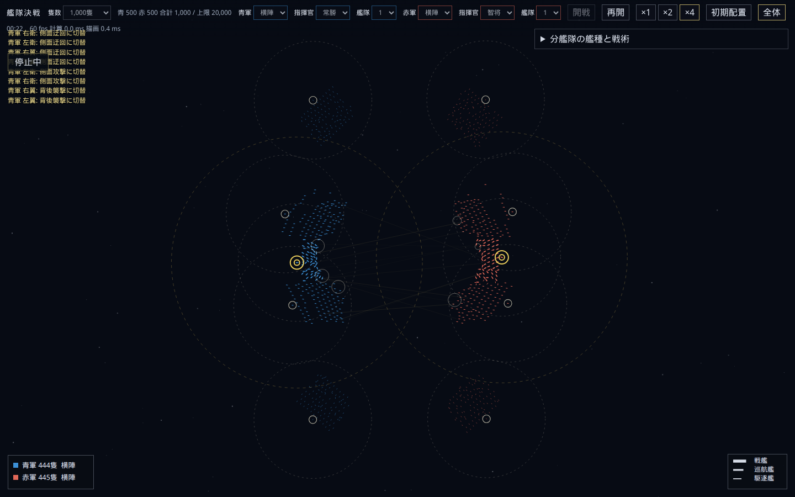

# 戦術の美しさ 第2回

第1回で採ったのは、五つの隊が一つの作戦で動く、です。両翼は同時に開き、全部隊の砲は同じ敵に集まります。この回は、その中の規則をどれにするかを選ぶための案です。

試したのはそのうちの一つだけです。1,000 隻、横陣対横陣、常勝対智将、ルールの指揮官、30 秒です。

| | 今の動き | 合図まで待つ試作 |
| --- | --- | --- |
| 最も撃たれた敵の隊への弾の割合 | 青 42%、赤 24% | 青 67%、赤 74% |
| 30 秒後の横の長さと厚さの比 | 3.2 と 2.0 | 8.7 と 9.3 |
| 左右の翼の位置のずれ | 最大 107 | 2〜8 |
| 30 秒までの損失 | 465 | 207 |

試作では両軍とも 4 秒で「両翼が所定の位置に着いた」となり、そのあと列は開戦時より横に広いまま保たれました。損失が少ないのは、距離を保って撃っているためで、勝ちが速いという意味ではありません。

左上の文字は、まだ古い戦術名のままです。足は一つの作戦なのに、画面は「側面迂回」と「背後襲撃」を別々に読んでいます。見せ方は、どの案でも後から足せますが、案 5 では最初から入れています。

## 案

### 1. 金床と槌

中央の隊が先に敵の正面へ出て、そこで相手を止めます。両翼は列に残ったまま待ちます。中央が砲の届く距離に入った瞬間を合図に、左右の翼が同時に側面へ回ります。撃つ的は、中央がいま押さえている敵の隊です。その隊が崩れたら、次の敵の隊を選んで、同じ形でもう一度やります。

画面では、まず中央どうしが向かい、しばらくしてから両翼が同じタイミングで前に出ます。弾は中央の相手に束になります。

規則は、合図が時計ではなく「中央が届いたか」です。翼は合図の前に回り込みを始めません。的は一つで、中央の接触先に固定します。

感じは、銀英で本隊が敵を引きつけ、翼が遅れて叩く絵です。深さは、中央をどれだけ前に出すか、翼を温存する時間です。猛将はこの待ちが短く、守将は中央が押されるまで翼を出しません。

リスクは、中央が先に潰れると作戦が始まらないことです。相手が中央を無視して翼を殴ると、金床がありません。

大きさは中くらいです。隊の足と、的を一つに固定する部分を変えます。計算は艦隊につき数回なので、1 万隻 12ms、6 艦隊 14ms の上限には影響しません。

### 2. 五つの隊が同時に出発する

作戦を出した瞬間、五つの隊が一緒に動きます。待ちません。道筋は左右対称で、中央は正面、翼は外側の弧です。的は作戦を出したときに選んだ敵の中央の隊で、約 20 秒はそのままです。20 秒経つか、その隊が消えたら、新しい作戦を出し直します。

画面では、命令と同時に陣全体が変形し始めます。片翼だけが先に着くことは、道の長さが同じなので起きにくいです。途中で相手が動くと、弧が空を切ることがあります。

規則は、時刻で始まり、時刻で終わることです。位置が揃ったかどうかは見ません。

感じは、号令一発で艦隊が一つの図形になる速さです。深さは、20 秒のあいだに相手が何をしてくるかを読んで、次の号令をいつ出すかです。常勝は間隔を長めに、猛将は短めにします。

リスクは、速い代わりに、翼が着く前に中央が撃ち負けても止まらないことです。空振りの弧が、第1回の「隊がばらばらに回る」に似て見えることがあります。

大きさは案 1 と同じくらいです。計算の増加はほとんどありません。

### 3. 両翼が着くまで撃たない

今回試した形です。左右の翼は、敵から見て対称な待機位置へ進みます。両方がその位置に着くまで、接近は中央だけがゆっくり行い、翼は突きません。両方が着いたら合図で、五つの隊が同じ敵の隊へ距離を詰め、砲をそこに集めます。片翼が合図の前に消えたら、作戦をやめて列に戻ります。的は、残っている敵の戦艦の隊のうち、一番大きいものです。

画面は上の図です。22 秒で、上下の翼が左右とも開いたまま、中央のあいだに弾が集まっています。数字では、一つの敵の隊への弾が 24〜42% から 67〜74% になり、横陣は潰れるどころか開戦時より横に広く残りました。左右のずれは数単位です。

規則は、時計ではなく「両翼の位置」です。片方だけでは始まりません。

感じは、手順が見える戦いです。深さは、相手が翼を崩しに来たときに作戦をやめるかどうかです。智将はこの待ちを好み、猛将は待ちを嫌うので、性格は「合図の厳しさ」で出せます。

リスクは、待ちのあいだに中央だけが撃たれることです。試作でも損失のペースは下がりましたが、それは距離を保った副作用で、中央が孤立すると逆になります。待機位置を遠くしすぎると、1 万隻の広い陣では翼が着く前に戦いが終わります。

大きさは中くらいです。試作は隊の目標位置と、的を一つにする処理だけで、艦の一台ずつの計算は増やしていません。この程度なら上限の内側です。

### 4. 一点を楔で突く

挟み撃ちではありません。敵の列の一番薄い隊、または列の端を一点に決め、五つの隊が同じ針路の楔になってそこへ進みます。横に開くのではなく、縦に重なります。砲はその一点に集まります。楔の先頭と後尾の向きが 30 度以上開いたら、隊が分裂したと見て作戦をやめ、列に戻ります。

画面では、艦隊が一つの矢じりになり、弾もその先の一点に集まります。横隊の美しさはなく、厚みと方向の美しさです。

規則は、役割が「外側と内側」ではなく「前と後ろ」です。全員の針路は同じです。

感じは、突破です。深さは、どの一点を突くかと、楔が割れたときに引く勇気です。猛将の性格に近く、守将はほとんどこの作戦を選びません。

リスクは、第1回で嫌った「縦の塊」に戻って見えることです。横列を残したいなら、この案は向きが違います。一点が硬い敵の戦艦だと、楔の先頭だけが溶けます。

大きさは中くらいです。隊を横ではなく縦に並べるだけなので、計算は案 3 と同じです。

### 5. 敵の旗艦を共通の的にする

共通の的は、いつも敵の旗艦が乗っている隊です。旗艦はすでに最後列の艦なので、的は敵の陣の後ろにいます。正面から撃つと前の隊が邪魔をし、側面か背後に回ってから旗艦の隊を撃てます。

役割は指揮官で変えます。猛将は待たずに五つの隊でその隊へ向かいます。智将は中央が正面を押さえ、旗艦の隊が翼に出るか薄くなるまで両翼を待ちます。守将は、相手がその隊を前に出してきたときだけ集中し、それまでは列を保って迎えます。常勝は、旗艦の隊が無防備ならすぐ集中し、そうでなければ案 1 の金床と槌にします。

画面では、各隊から的への薄い矢印と、短い役割の文字を出します。「押さえる」「回る」「撃つ」。今の試作のように、古い戦術名が別々に並ぶことはやめます。旗艦の輪と矢印の先が一致するので、誰を狙っているかが一目です。

規則は、的の選び方が「大きい隊」ではなく「旗艦の隊」です。旗艦が沈んで次の艦へ移ったら、的もそちらへ移り、作戦は短く組み直します。

感じは、狙いが人ではなく旗に読める戦いです。深さは、旗艦を最後列に隠すか、翼へ出して誘うかです。第1回の「砲が列を報いない」問題は、この案だけでは解けません。旗を狙う理由は、指揮が途切れることです。

リスクは、旗艦が最後列にいる今の規則だと、的がいつも奥にあり、正面の撃ち合いが「手前の隊を無視して奥を撃つ」ように見えることです。矢印を毎フレーム全艦に描くと 1 万隻で描画が重くなります。矢印は隊につき一本、五本なら無視できます。

大きさは中くらいです。的の選び方と、画面の印が主で、足は案 1 か案 3 を借りられます。計算の本体は増えません。

## 比べると

| 案 | 合図 | 的 | 形 | 性格の出し方 |
| --- | --- | --- | --- | --- |
| 1. 金床と槌 | 中央が砲の距離に入る | 中央が押さえている隊 | 中央が先、翼はあと | 待ちの長さ |
| 2. 同時出発 | 号令の瞬間 | そのとき選んだ中央の隊 | 左右対称の弧 | 作戦を持ち続ける時間 |
| 3. 着くまで待つ | 両翼が位置に着く | 一番大きい戦艦の隊 | 広い横陣のまま | 合図の厳しさ |
| 4. 楔で突く | 隊の向きが割れたら中止 | 一番薄い隊 | 縦の矢じり | 猛将が好む |
| 5. 旗艦を的に | 旗艦が移ったら組み直す | 旗艦の隊 | 性格ごとの役割 | 役割そのもの |

案 3 だけ、上の数字と絵で確認しています。ほかはまだ絵にしていません。

次は、この五つのうち一つを選んでください。選ばれたものの中で、待ち方や的や、やめる条件をさらに分けます。
