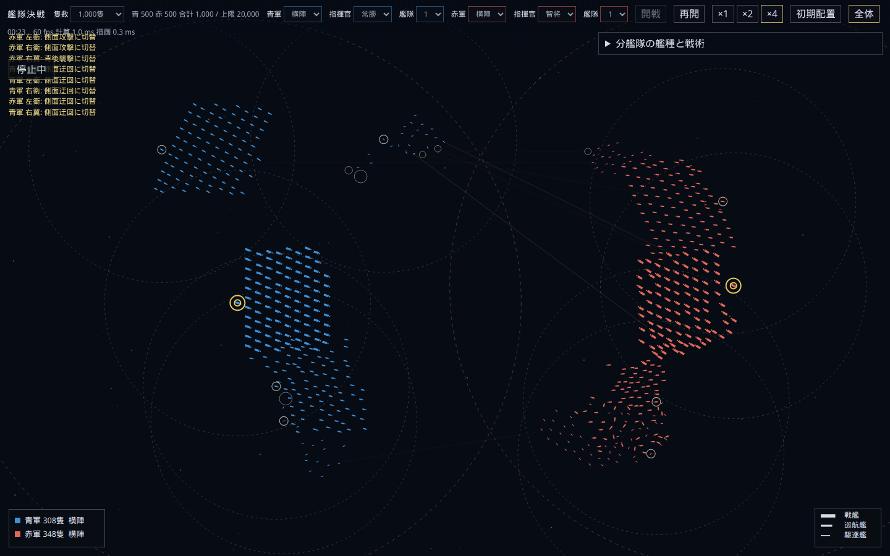
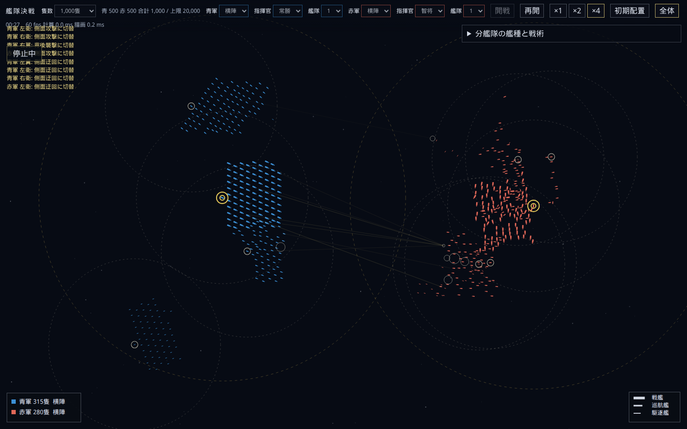

# 戦術の美しさ 第3回

第2回で採ったのは金床と槌です。中央の隊が敵を砲の届く距離に入れたのを合図に、両翼が同時に前へ出て、撃つ相手は中央が押さえている敵の隊です。この回は、その槌と金床の作り方をどれにするかを選ぶための案です。

試したのは二つです。どちらも青軍だけが新しい動きで、赤軍は今の main のままです。1,000 隻、横陣対横陣、常勝対智将、ルールの指揮官、種子 3 と 7、40 秒です。砲の届く距離は戦艦の艦首で 900 です。合図はその距離に中央が入ったときで、両種子とも 4 秒でした。

| | 今の動き | 両翼を浅く回す | 片翼を深く回す |
| --- | --- | --- | --- |
| 押さえている隊に当たった弾 | 的を決めていない | 55% と 59% | 59% と 64% |
| 一つの隊に最も集まった弾 | 42% と 46% | 40% と 42% | 44% と 45% |
| 赤が 80 隻失うまで | 16 秒と 16 秒 | 16 秒と 14 秒 | 14 秒と 14 秒 |
| 30 秒の損失、青 / 赤 | 160/182、202/204 | 238/196、242/195 | 203/224、195/236 |
| 30 秒の青の幅と厚さの比 | 3.2 と 2.9 | 1.6 と 1.5 | 1.9 と 1.8 |
| 30 秒の青の幅 | 577 と 507 | 540 と 522 | 829 と 768 |

弾は、そのとき押さえている隊には集まります。ただし的は隊が小さくなると隣へ移るので、一つの隊だけに溜まる割合は今とほぼ同じです。浅い両翼は赤を少し多く削りますが、青の損失の方が増えます。深い片翼は赤をやや速く削り、幅は今より残ります。どちらも、翼が前へ出るので艦隊全体は横長の帯ではなくなります。

左上の文字は、まだ古い戦術名です。足は金床と槌でも、画面は「側面迂回」と読んでいます。

## 案

### 1. 両翼を浅く、正面の隊を叩く

金床は中央の戦艦の隊だけです。その左右の巡航艦は金床の線に残し、旗艦は今どおりその隊の最後列に置いたまま動かしません。槌は両翼の駆逐艦です。合図の前は、翼も同じ横列で待ちます。中央が敵のいちばん近い隊から 900 以内に入ったら、両翼が同時にその隊の真横、少し手前まで出ます。背後までは回りません。その隊の残存が 3 割を切ったら、中央の正面にいる次の隊へ的を移し、翼もそちらへ向きを変えます。

画面は上の 1 枚目です。金床が正面に残り、翼が上下に分かれます。弾は赤の正面に向かいます。

感じは、決めた形に一番近いです。深さは、的が折れた瞬間に次の隊へ移るタイミングです。早すぎると弾が散り、遅すぎると空の隊を撃ち続けます。

リスクは、試作で見えたとおり、翼が出たあとの艦隊が横長でなくなることと、青の損失が増えることです。4 秒で合図が出るので、列を整える暇がほとんどありません。相手の翼がこちらの槌の外側に回ると、止める規則がまだありません。

大きさは中くらいです。隊の目標位置と、的を一つにする処理です。艦ごとの計算は増やしていないので、1 万隻 12ms、6 艦隊 14ms の上限には影響しません。

### 2. 開いている側の片翼だけを、背後まで回す

金床は中央と両側の巡航艦、三隊です。槌は一隊だけです。敵の艦が厚くいる側の反対、海が開いている側の翼を選びます。もう一方の翼は金床の横に残します。合図は案 1 と同じで、中央が 900 以内に入ったときです。槌はまず大きく外側へ出て、そこまで着いてから敵の隊の背後へ入ります。真横で止める案 1 より深いです。

画面は 2 枚目です。青の本体が左にあり、一方の翼が上に離れ、弾が赤の塊に集まっています。30 秒の幅は 829 と 768 で、今の 577 と 507 より残ります。赤が 80 隻失うのは 14 秒で、今より 2 秒早いです。種子 3 では青の損失も今に近く、種子 7 では青の方が多く失いました。

感じは、片手で押さえて片手で回る絵です。深さは、どちら側を空いていると判断するかです。読みを外すと、槌が敵の厚い方へ入ります。

リスクは、もう一方の翼が遊んで見えることと、背後までの道が長いので槌が着く前に金床が負けることです。試作は 27 秒でも背後までは入り切っておらず、外側で弾を撃っていました。

大きさは案 1 と同じです。計算も同じで、上限の内側です。

### 3. 相手が傷んでから槌を出す

合図を距離だけにしません。中央は止まらず、ゆっくり前へ出ます。押さえている敵の隊が、隻数のおよそ 4 分の 1 を失うまで、翼は横列のまま待ちます。傷んでから両翼が同時に、案 1 と案 2 の中間の深さ、真横より少し後ろまで出ます。傷む前に相手が距離を開いたら、槌は出さず中央も止まります。

画面では、しばらく二つの横列が撃ち合い、片方の列が薄くなったところから翼が出ます。4 秒で翼が動く試作より、列の時間が長く残るはずです。

感じは、焦らない槌です。深さは、4 分の 1 という閾値です。低くすれば早く、高くすれば金床だけで決まる戦いが増えます。

リスクは、閾値に達する前に中央が溶けることです。相手が損害を隊のあいだで分散させると、槌が永久に出ません。この案はまだ絵にしていません。

大きさは案 1 に、損害の数え足しです。隊の残存はすでに毎ステップ数えているので、計算は増えません。

### 4. 折れた隊の隣から、列を巻き上げる

最初の槌は案 1 です。的の隊が 3 割を切ったら、そこで終わりにしません。その敵の隣にいる隊を次の金床の正面にし、近い方の翼が新しい金床の横へ下がり、遠い方の翼が次の隊の側面へ進みます。列の端までこれを繰り返します。

相手も金床と槌できたとき、または敵の隊がこちらの槌より外側に出たときは、巻き上げをやめて金床を一歩下げ、槌を列へ戻します。下がっているあいだは撃ち合いますが、回り込みはしません。

画面では、翼が敵の列に沿って端へ端へと滑っていきます。失敗すると、翼が戻って二つの線に戻ります。

感じは、一度突破したあとの手順がある戦いです。深さは、巻き上げを続けるか、相手の槌を見て引くかです。

リスクは、隣の選び方を誤ると翼が敵の厚いところへ入ることです。両軍が同時に巻き上げると、第 1 回のすれ違いに戻ります。引く条件が敏感だと、槌が何度も出たり戻ったりして忙しく見えます。この案もまだ絵にしていません。

大きさは案 1 より一回り大きいです。隣の隊と、外側に回られたかの判定が要ります。それでも隊は五つなので、上限には影響しません。

### 5. 性格で槌の深さを変え、画面に道を描く

作戦の骨格は案 1 か案 2 を借り、指揮官で変えます。猛将は両翼を、砲の距離より手前、およそ 1,200 で深く出します。智将は片翼だけを背後まで回し、もう片翼は旗艦の前に残して金床を守ります。守将は自分から出さず、敵の中央が 700 より近くに来るまで翼を列に置きます。常勝は案 1 の浅い両翼で、的が折れたら隣へ移します。

画面では、槌の予定の弧を薄い線で引き、隊のそばに「金床」か「槌」と出します。今の「側面迂回」「背後襲撃」は、この作戦のあいだは出しません。旗艦の輪は金床の後ろに残し、槌には乗せません。

感じは、誰の艦隊かが見た目で分かり、狙いが読めます。深さは、相手の性格を見て自分の槌を深くするか浅くするかです。

リスクは、印が説明になりすぎて、艦の動きより文字を見てしまうことです。弧は隊につき一本ずつ、多くて二本なので、1 万隻の描画にはほとんど乗りません。艦ごとに線を引くと重くなります。

大きさは中くらいです。動きは案 1 と案 2 の組み合わせで、足すのは性格の数値と、隊の印です。

## 比べると

| 案 | 金床 | 槌 | 合図 | 試作で見えたこと |
| --- | --- | --- | --- | --- |
| 1. 浅い両翼 | 中央の戦艦 | 両翼、真横まで | 900 以内 | 弾は 55〜59% が的へ。青の損失は増える |
| 2. 深い片翼 | 中央と巡航艦 | 開いている側の一隊、背後まで | 900 以内 | 赤をやや速く削る。幅は今より残る |
| 3. 傷んでから | 中央がゆっくり進む | 両翼、中くらいの深さ | 敵が約 4 分の 1 減る | まだ試していない |
| 4. 巻き上げ | 折れた隣へ移る | 一方が新しい金床、一方が次の側面 | 3 割を切る、または外側に回られる | まだ試していない |
| 5. 性格と印 | 性格で隊数が変わる | 深さとタイミングが変わる | 性格ごと | まだ試していない。今の画面は古い名前のまま |

次は、この五つのうち一つを選んでください。選ばれたものの中で、距離や隊の数や、やめる条件をさらに分けます。
