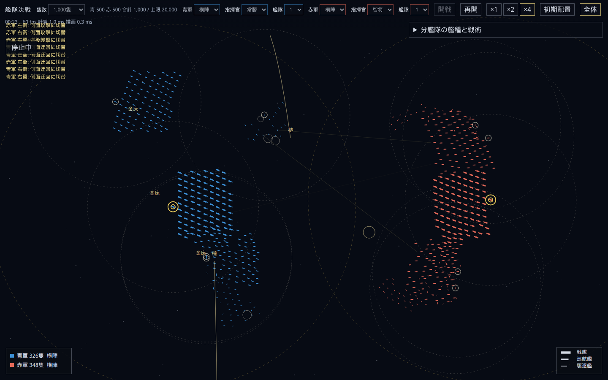
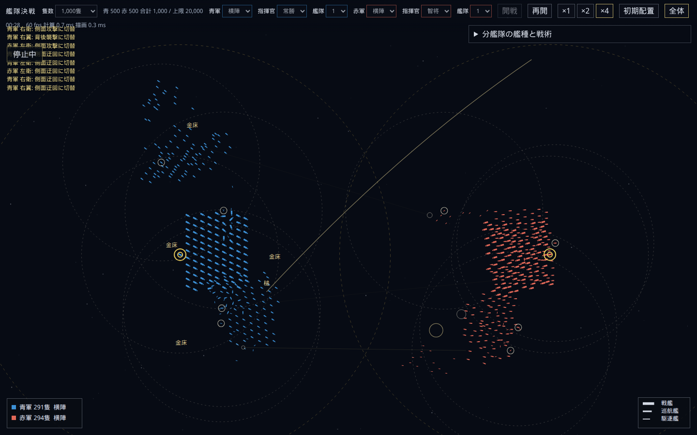

# 戦術の美しさ 第4回

第3回で採ったのは、三つの組み合わせです。土台は浅い両翼です。中央が敵を砲の届く距離に入れたら、両翼が同時に出て、的は中央が押さえている敵の隊です。その隊が折れたら、近い翼が次の金床になり、遠い翼は列の端へ進みます。槌が外側に回されたら、槌は列へ戻ります。指揮官ごとに槌のタイミングと深さと形を変え、画面には予定の弧と「金床」「槌」を出します。

第3回の弱い点は二つです。浅い両翼は青の損失を増やしました。そして艦隊が横長の帯ではなくなりました。この回は、その二つを直しつつ、巻き上げと性格と印を具体的にする案です。

試したのは二つです。青軍だけ新しい動き、赤軍は今の main のままです。1,000 隻、横陣対横陣、常勝対智将、ルールの指揮官、種子 3 と 7、40 秒です。第3回の浅い両翼も、同じ条件の数字を並べます。

| | 今の動き | 第3回の浅い両翼 | 翼を蝶番で回す | 折れたら巻き上げ |
| --- | --- | --- | --- | --- |
| そのとき押さえている隊への弾 | 的を決めていない | 55% と 59% | 60% と 60% | 62% と 67% |
| 一つの隊に最も集まった弾 | 42% と 46% | 40% と 42% | 41% と 46% | 45% と 37% |
| 赤が 80 隻失うまで | 16 秒と 16 秒 | 16 秒と 14 秒 | 15 秒と 15 秒 | 15 秒と 13 秒 |
| 30 秒の損失、青 / 赤 | 160/182、202/204 | 238/196、242/195 | 215/182、223/204 | 252/207、255/245 |
| 30 秒の青の幅 | 577 と 507 | 540 と 522 | 555 と 573 | 518 と 482 |
| 30 秒の青の厚さ | 181 と 175 | 339 と 346 | 432 と 376 | 327 と 286 |
| 30 秒の幅と厚さの比 | 3.2 と 2.9 | 1.6 と 1.5 | 1.3 と 1.5 | 1.6 と 1.7 |

蝶番も巻き上げも、押さえている隊への弾は 60% 前後まで上がります。一つの隊だけに溜まる割合は、的が次へ移るので今とあまり変わりません。赤を倒す速さは、今の 16 秒から 13〜15 秒です。青の損失は、第3回より蝶番の方が少し少ないですが、今の動きよりはまだ多いです。厚さはどちらも今の約 180 から 300〜430 に増えていて、横長の帯は戻っていません。

巻き上げが次の隊へ移ったかは、的の番号で見ました。どちらの種子も、最初の隊のあと 6、9、5 と別の隊に移っています。二つ目と三つ目には進みます。ただしそのあと 6 や 7 に戻っていて、列の端へ一方向には進んでいません。

1 万隻で両軍に蝶番を付けたステップは中央値 5.11ms です。上限は 12ms です。6 艦隊で合計 1 万隻は 4.02ms です。上限は 14ms です。6 艦隊のときは、この作戦自体は動かさず、今の動きの時間です。印は隊につき一つなので、描画の増加は小さいです。

文字が隊の上に重なり、弧が画面を横切っています。左上には、まだ古い戦術名が出ています。

## 案

### 1. 翼の角度を、列から 35 度で止める

槌は敵の真横まで飛びません。巡航艦の隊を軸に、元の横列から 35 度だけ回します。軸から翼までの距離は、開戦時の隊の間隔のままです。それ以上は前へ出ません。的が 3 割を切ったら、同じ角度のまま次の隊の方へ向きだけ変えます。

画面では、横列が端で少し折れ、全体はまだ一本の帯です。今回の蝶番は、真横の点に向かって 420 進ませたので、厚さは 180 から 400 前後まで増えました。35 度で止めれば、この厚さは出ないはずです。まだその角度だけでは試していません。

感じは、列を保ったまま端だけが敵を抱く絵です。深さは、35 度で側面を取れるか、足りなければ一度だけ 50 度まで許すかです。

リスクは、35 度では敵の真横に着かず、槌が金床の斜め前で止まることです。側面を取る味が薄くなります。

大きさは小さいです。今回の蝶番に、角度の上限を一つ足します。計算は変わりません。

### 2. 折れた隊には戻らず、隣だけへ進む

的が残存 3 割を切ったら、その隊は終わりにします。次は、選んだ端の方向にいる隣の隊だけです。一度外した隊には戻りません。近い翼は、その隣の正面に着いて砲の距離に入るまでが新しい金床で、そのあいだ遠い翼は動きません。新しい金床が着いてから、遠い翼が列の端へ進みます。

画面では、翼が敵の列に沿って一方向へずれていきます。行ったり来たりしません。

今回の試作は、的が 7、6、9、5 と進んだあと、6 や 7 に戻っていました。戻るたびに弾が分かれ、一つの隊に最も集まった割合が 37% まで落ちた種子があります。戻らない規則は、その分散を止めるためのものです。まだその禁止だけでは試していません。

感じは、突破した側から順に畳む手順です。深さは、どちらを端と決めるかです。逆の端を選ぶと、厚い方へ進みます。

リスクは、隣がまだ健在だと、新しい金床が着く前に負けることです。遠い翼を待たせるので、第3回より槌が遅くなります。

大きさは中くらいです。的の履歴と、隣の判定が要ります。隊は五つなので、計算は増えません。

### 3. 槌の外側に、巡航艦を一隊置く

各槌のすぐ外側を、隣の巡航艦が歩きます。敵の隊が槌より外側に出て、槌から 700 以内に入ったら、その巡航艦が間に入り、槌は横列の位置へ戻ります。戻っているあいだ、その翼は撃ちますが回り込みません。反対の翼はそのままです。

画面では、回っている翼の外側に、もう一つの隊が壁として見えます。敵がそこを越そうとすると、翼が列へ戻ります。

第3回も今回も、青の 30 秒の損失は今の 160〜202 より多く、215〜255 でした。試作にも「外側に回られたら戻る」は入っていましたが、戻ったあとも損失は減り切っていません。巡航艦を最初から外側に置く方が、戻ってから守るより早い、という案です。

感じは、槌がむき出しにならない戦いです。深さは、700 という距離です。広くするとすぐ戻り、狭くすると守る前に削られます。

リスクは、巡航艦が金床から離れるので、中央が薄くなることです。両側を同時に回られると、両翼が戻ってただの横列になります。

大きさは中くらいです。案 1 か案 2 に、巡航艦の位置を一つ足します。計算は変わりません。

### 4. 四人の指揮官で、距離と角度と巻き上げを変える

動きの種類は案 1 から案 3 までを共用し、数値だけ変えます。

猛将は、距離 1,200 で両翼を 60 度まで回します。折れたら待たずに隣へ進み、外側に回られても戻りません。

智将は、距離 900 で片翼だけを 70 度、背後に近いところまで回します。もう片翼は旗艦の前に残します。巻き上げは、薄い側の端だけです。外側に回られたら戻ります。

守将は、敵の中央が 700 より近くに来るまで翼を出しません。出す角度は 25 度です。自分の損失が相手より多いあいだは、巻き上げません。

常勝は、距離 900、角度 35 度、両翼です。3 割で隣へ進み、前の隊には戻りません。外側に回られたら、その翼だけ戻します。

画面では、同じ金床と槌でも、猛将の弧が長く、守将の弧が短いので、誰の艦隊かが見えます。

感じは、性格が戦術の名前ではなく、槌の待ちと深さになることです。深さは、相手の数値を見て自分の角度を一つ変えるかどうかです。

リスクは、数値が四つずつあるので、一つを強くすると他の三人の区別が消えることです。猛将の 60 度は、今回の試作と同じように列を厚くする恐れがあります。

大きさは中くらいです。共通の動きが決まっていれば、足すのは数値の表です。計算は変わりません。

### 5. 印は、槌の弧が二本と、的の輪が一つ

各隊に「金床」か「槌」を、艦の少し上に短く出します。弧は槌の隊だけ、今の位置から目標まで一本です。的の隊には輪を一つ。これ以外は出しません。作戦のあいだ、左上の古い戦術名は隠します。

今回の画面では、文字が隊の上に重なり、弧が戦場を横切っていました。目標で止め、文字を隊の外側へずらせば、艦は隠れません。弧は多くて二本、文字は五つ、輪は一つです。

1 万隻のステップは 5.11ms でした。印はそのステップの外の描画で、隊の数だけなので、艦の数では増えません。

感じは、今どこが金床で、槌がどこへ行くかを、ログを読まずに分かることです。深さは増えません。見るためのものです。

リスクは、弧が艦の動きとずれて、約束と違う場所へ見えることです。目標が毎秒変わると、弧がちらつきます。的を数秒は固定すると、これは収まります。

大きさは小さいです。描くものだけで、動きの規則は案 1 から案 4 のどれかに乗ります。

## 比べると

| 案 | 直したいこと | まだ試していないこと |
| --- | --- | --- |
| 1. 35 度で止める | 列が厚くなる | 角度の上限そのもの |
| 2. 隣だけへ進む | 的が前の隊に戻る | 戻ることを禁じる規則 |
| 3. 巡航艦が槌の外 | 青の損失が増える | 最初から護衛を置くこと |
| 4. 四人の数値 | 性格が画面に出ない | 四人を並べた戦い |
| 5. 弧二本と輪一つ | 印が重なって見えない | 文字の位置をずらすこと |

次は、この五つのうち一つを選んでください。選ばれたものを、角度や距離や、戻る条件の具体的な数に分けます。
