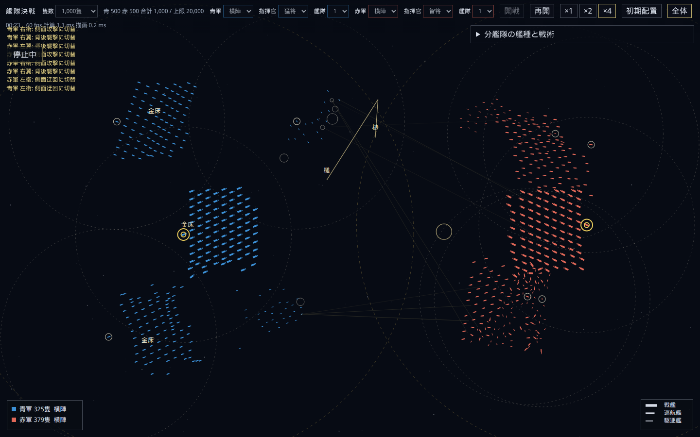
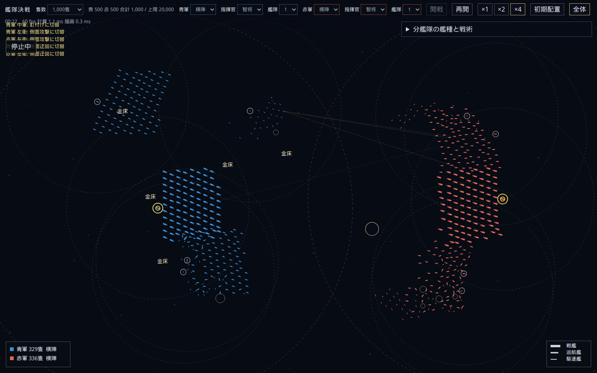
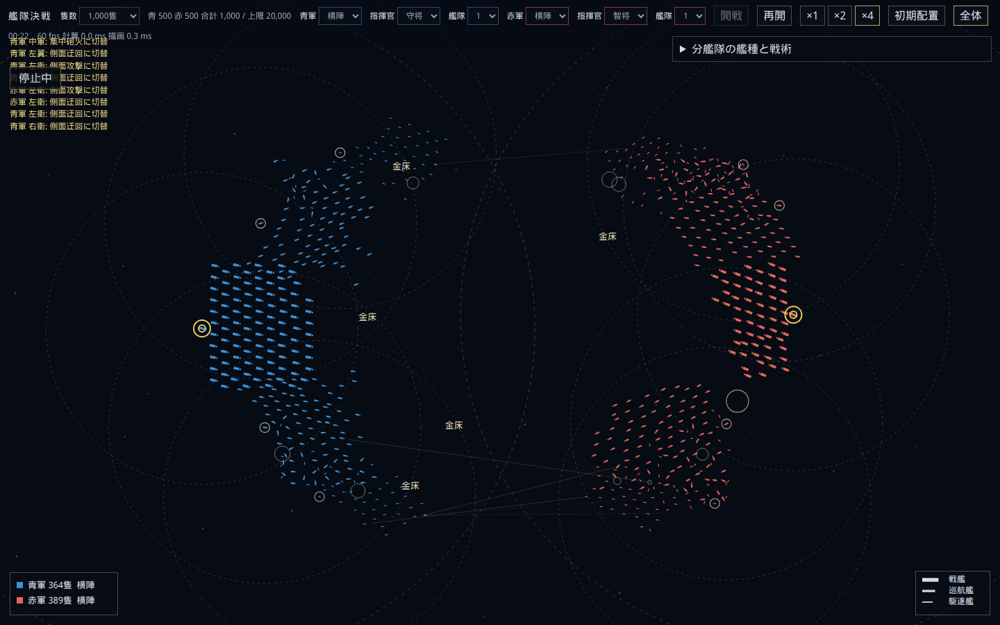
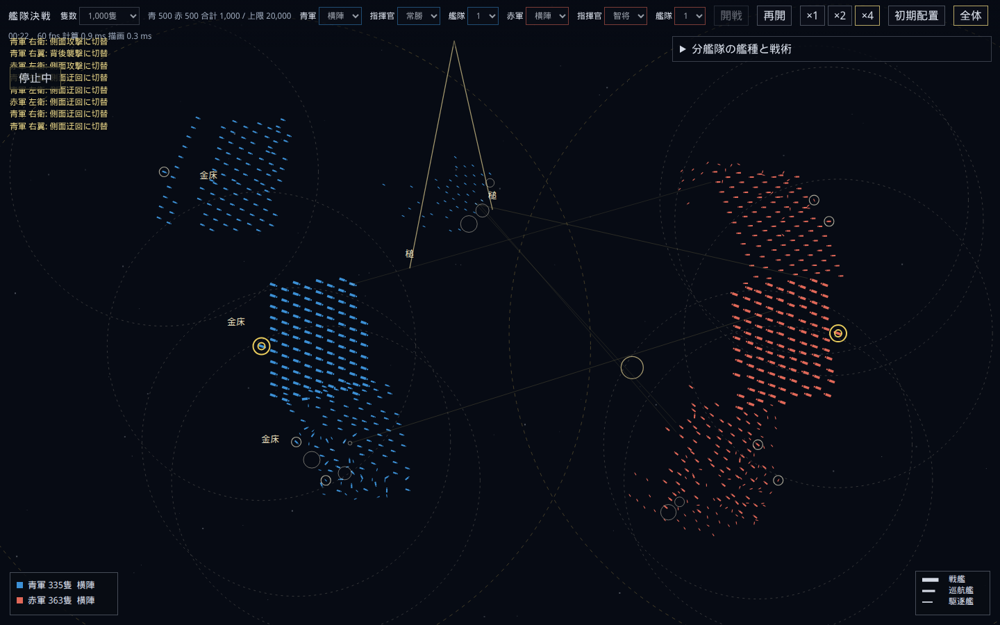

# 戦術の美しさ 第5回

第4回で採ったのは、四人の指揮官ごとの数値だけです。35 度で止めること、隣の隊だけへ進むこと、巡航艦を槌の外に置くこと、印を弧二本に絞ることは採っていません。未決のままです。

仮の表は次です。

| | 動き始める距離 | 回す角度 | 翼 | 的を変える残存 | 前の的に戻る | 外側に回されたら |
| --- | --- | --- | --- | --- | --- | --- |
| 猛将 | 1,200 | 60 度 | 両翼 | 45% | 戻る | 戻らない |
| 智将 | 900 | 70 度 | 薄い側の一翼 | 30% | 戻らない | 戻る |
| 守将 | 700 | 25 度 | 両翼 | 30% | 戻らない | 戻る |
| 常勝 | 900 | 35 度 | 両翼 | 30% | 戻らない | 戻る |

守将は、自分の損失が相手以上のあいだは的を変えません。金床は中央の戦艦、槌は駆逐艦の翼です。旗艦はその中央の最後列のままです。

この表を、青軍だけに載せ、赤軍は今の main の智将のままにしました。1,000 隻、横陣対横陣、ルール、種子 1、3、5、7、40 秒です。勝ちは 40 秒時点で残存が多い方です。

| | 今の常勝 | 猛将 | 智将 | 守将 | 常勝の表 |
| --- | --- | --- | --- | --- | --- |
| 40 秒の勝敗 | 2 勝 1 敗 1 分 | 1 勝 3 敗 | 4 勝 | 0 勝 3 敗 1 分 | 4 勝 |
| 合図 | なし | 0 秒 | 4 秒 | 8〜9 秒 | 4 秒 |
| 押さえている隊への弾 | 的なし | 48〜51% | 46〜55% | 42〜50% | 41〜47% |
| 一つの隊に最も集まった弾 | 42〜46% | 34〜42% | 27〜32% | 42〜50% | 27〜31% |
| 赤が 80 隻失うまで | 16〜17 秒 | 14〜15 秒 | 14〜15 秒 | 19〜21 秒 | 13〜15 秒 |
| 30 秒の損失、青 | 160〜202 | 224〜272 | 204〜221 | 192〜239 | 215〜225 |
| 30 秒の損失、赤 | 165〜204 | 183〜202 | 175〜228 | 144〜167 | 193〜214 |
| 30 秒の幅×厚さ | 507〜577 × 160〜212 | 549〜666 × 234〜306 | 558〜567 × 353〜484 | 489〜538 × 210〜269 | 543〜571 × 310〜409 |
| 移った的の数 | なし | 6〜7。前の隊に戻る | 5。戻らない | 1。変えない | 5。戻らない |

猛将はすぐ両翼を出し、的を行き来するので、弾が分かれ、4 戦中 3 敗です。智将は片翼だけで、列は一番厚くなりますが、4 戦とも残存で勝っています。守将は 8 秒過ぎまで翼を出さず、的を一つに保ちます。赤を削るのが遅く、4 戦中 3 敗です。常勝の表は 4 戦とも勝ち、赤が 80 隻失うのは一番早い 13〜15 秒です。ただし厚さは今の約 180 から 310〜409 に増えます。青の 30 秒の損失も、今の常勝より多いです。

二人とも新しい表にした対戦も二種だけ見ました。猛将対守将は 1 勝 1 敗。智将対常勝は、智将が 2 勝でした。

1 万隻で両軍にこの表を載せたステップは中央値 5.07ms です。上限は 12ms です。6 艦隊で合計 1 万隻は 4.01ms です。上限は 14ms です。6 艦隊ではこの作戦は動かしていません。

四人は、弧の長さと翼の数で見分けがつきます。文字が重なることと、左上に古い戦術名が残ることは、第4回で採らなかった印の整理のままです。

## 案

### 1. この表を固定する

上の数値を、状況で変えません。猛将は早く深く、智将は片翼、守将は遅く浅く、常勝はその中間で、前の的には戻らず、外側に回されたらその翼だけ戻します。

画面は四枚のとおりです。同じ横陣でも、22 秒で形が違います。

遊びは、指揮官を選ぶことが槌の待ちと深さを選ぶことになります。深さは、この表の勝ち負けです。今の智将に対しては常勝と智将が勝ち、猛将と守将は負けています。

リスクは、常勝が勝っても列が厚くなり、30 秒の青の損失が今より多いことです。猛将は的を行き来して、弾が 34% まで分かれます。

大きさは中くらいです。隊の目標を角度で置くだけです。1 万隻のステップは 5.07ms で、上限の内側です。

### 2. 常勝だけ、劣勢では守将、優勢では猛将の数値を借りる

常勝の 35 度を、いつも使いません。自分の損失が相手より多いあいだは守将の 25 度と 700 に下げ、巻き上げも止めます。残存が相手より 40 隻以上多いあいだは、猛将の 60 度に上げます。それ以外は 35 度です。他の三人は固定です。

画面では、同じ常勝でも、押されているときは翼が列に近く、押しているときは弧が長くなります。

感じは、常勝が相手を見て槌を調整することです。深さは、40 隻という境目です。

リスクは、境目の前後で弧が伸び縮みし、意図が読みにくくなることです。今回の 4 勝は、35 度のままの結果なので、借り始めると勝ちが減るかもしれません。この切り替えはまだ試していません。

大きさは小さいです。常勝の数値を、損失の差で差し替えるだけです。計算は変わりません。

### 3. 隻数で角度を縮める

100 隻では表の角度のまま、1,000 隻でも表のまま、10,000 隻では角度を半分にします。猛将の 60 度は 30 度、常勝の 35 度は 18 度です。距離と、翼が片側か両側かは変えません。

画面では、小さい戦いでは四人の差が大きく、大きい戦いでは四人とも横列に近くなります。1 万隻で列が塊になるのを避けます。

感じは、艦が多いほど列の形を優先することです。深さは、半分にする境目を 1,000 にするか 5,000 にするかです。

リスクは、1 万隻では四人の見た目が似て、性格が消えることです。今回 1 万隻で見たのはステップの 5.07ms だけで、角度を半分にした形はまだ見ていません。

大きさは小さいです。角度に艦隊の隻数をかけるだけです。計算は変わりません。

### 4. 見分けは、翼の数と弧の長さだけにする

新しい印は足しません。猛将は長い弧が二本、智将は長い弧が一本、守将は短い弧が二本か、ほとんど弧がない、常勝は中くらいの弧が二本。文字の「金床」「槌」はあってもなくても、形で分かれば足ります。

四枚の画面は、すでにその方向です。守将は翼が出ておらず、智将は槌が一隊、猛将と常勝は二隊で、猛将の方が前に出ています。

感じは、ログを読まなくても誰の艦隊か分かることです。深さは増えません。

リスクは、角度が近い常勝と守将が、遠目では同じに見えることです。智将の一翼は、片方が遅れているだけにも見えます。

大きさは、案 1 の見た目そのものです。追加の計算はありません。

### 5. ばらばらの数値を、一人につき一つの型に束ねる

距離、角度、片翼、戻る、を別々に動かすと、守将に 70 度を足すような矛盾が起きます。一人を一つの型にします。猛将は「早く、両翼、深く、戻らない」。智将は「片翼だけ、深く、回されたら戻る」。守将は「遅く、浅く、不利なあいだは的を変えない」。常勝は「中間の両翼、前の的には戻らない、回されたら戻る」。型の中の数値は、その言葉から外れません。

画面では案 4 と同じです。違いは、あとから数値をいじっても性格が混ざらないことです。

感じは、調整が性格の言葉のままであることです。深さは、型を四つより増やすかどうかです。

リスクは、細かい数値で勝率を上げる余地が減ることです。今回の常勝の 4 勝は、この型の中に収まっています。猛将の的の行き来は「戻らない」に入っていないので、型にすると猛将の動きは今の試作と変わります。

大きさは小さいです。表を四つに固定するだけです。計算は変わりません。

## 比べると

| 案 | 変えること | 試作 |
| --- | --- | --- |
| 1. 表を固定 | 上の数値のまま | この回の数字と四枚の絵 |
| 2. 常勝が借りる | 常勝だけ損失で 25 度か 60 度 | まだ |
| 3. 隻数で縮める | 1 万隻では角度を半分 | ステップだけ 5.07ms |
| 4. 弧と翼の数 | 印を足さず形で見分ける | 四枚の絵 |
| 5. 一つの型 | 数値の矛盾を禁じる | 表の整理。動きは案 1 と同じ |

次は、この五つのうち一つを選んでください。
