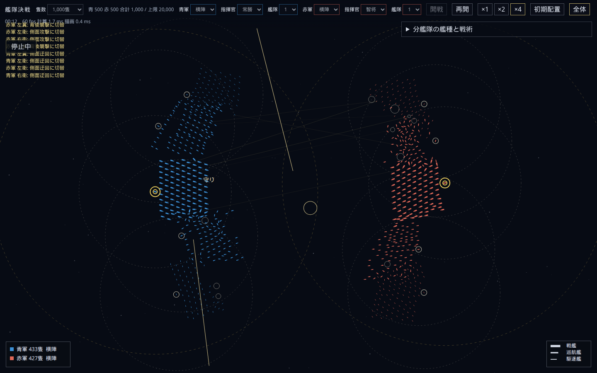
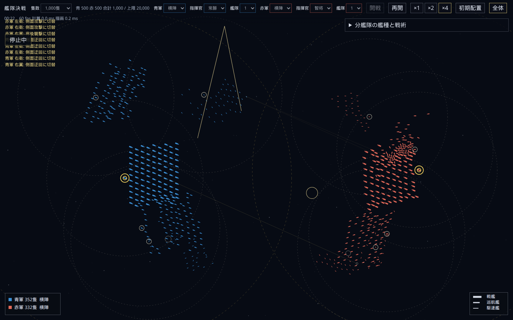
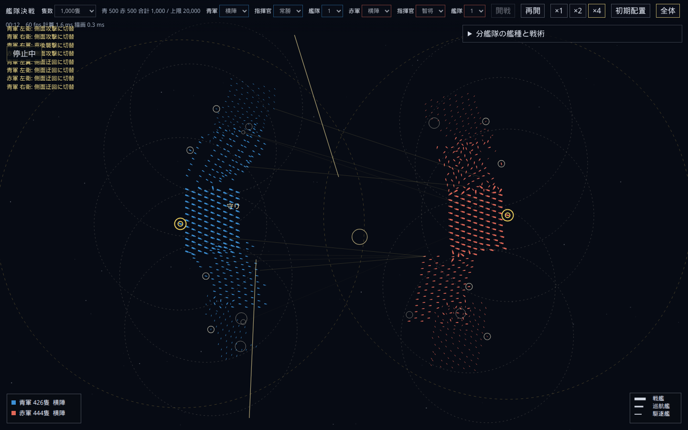
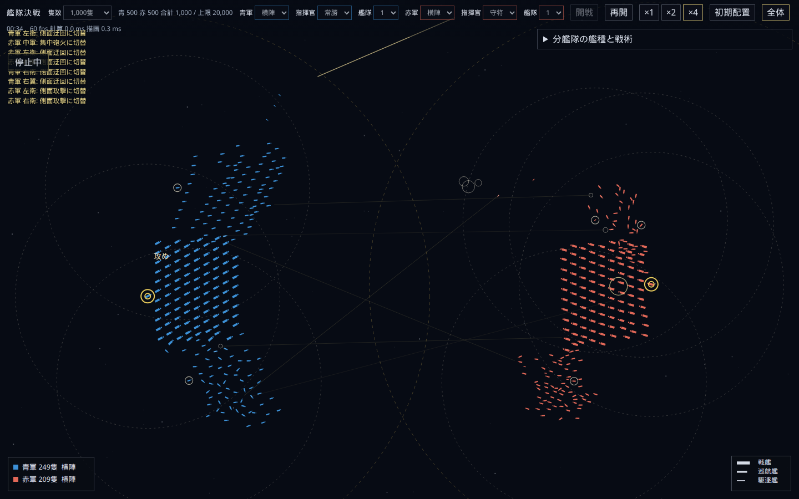
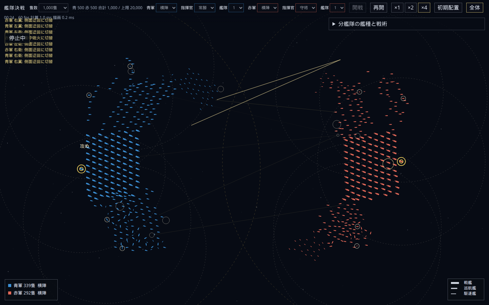

# 戦術の美しさ 第6回

第5回で採ったのは、常勝だけが借りることです。負けているあいだは守将の 25 度、残存が 40 隻以上多いあいだは猛将の 60 度。土台は 900 と 35 度です。猛将、智将、守将の三人は表のままです。

採らなかったのは、表を最終にすること、隻数で角度を変えること、見分けを翼の数と弧の長さだけにすること、数値を一つの型に束ねることです。未決のままです。

試したのは二つです。どちらも常勝だけが借り、他の三人の型は触っていません。借りるのは角度と、その角度についていた距離です。守りは 25 度と 700、通常は 35 度と 900、攻めは 60 度と 1,200。猛将が的を行き来する動きはコピーしていません。的は前の隊へ戻さず、外側に回された翼は列へ戻します。翼は両翼のままです。守将が不利なあいだ的を変えない、という止まりもコピーしていません。

画面の中央には「守り」「通常」「攻め」の一語を出します。

青軍は常勝、赤軍は今の main の智将です。1,000 隻、横陣対横陣、ルール、種子 1、3、5、7、40 秒です。勝ちは 40 秒時点で残存が多い方です。

| | 今の常勝 | 表のまま 35 度 | その場で差し替え | 帯とゆっくり |
| --- | --- | --- | --- | --- |
| 40 秒の勝敗 | 2 勝 1 敗 1 分 | 4 勝 | 2 勝 2 敗 | 3 勝 1 敗 |
| モードの切り替え | なし | なし | 5、9、13、14 回 | 1、2、2、3 回 |
| 合図 | なし | 4 秒 | 4 秒 | 4 秒 |
| 押さえている隊への弾 | 的なし | 41〜47% | 36〜56% | 41〜60% |
| 一つの隊に最も集まった弾 | 42〜46% | 27〜31% | 26〜32% | 26〜38% |
| 赤が 80 隻失うまで | 16〜17 秒 | 13〜15 秒 | 13〜16 秒 | 14〜16 秒 |
| 30 秒の損失、青 | 160〜202 | 215〜225 | 199〜271 | 211〜240 |
| 30 秒の損失、赤 | 165〜204 | 193〜214 | 180〜251 | 192〜257 |
| 30 秒の幅×厚さ | 507〜577 × 160〜212 | 543〜571 × 310〜409 | 517〜565 × 227〜388 | 518〜640 × 213〜331 |

その場で差し替える方は、4 秒で守りに入り、同じ秒のうちに通常へ戻り、また守りへ落ちます。4 戦とも最初の十数秒で守りと通常を往復します。60 度の攻めまで届いたのは 1 戦だけで、36 秒でした。2 勝 2 敗です。

帯の方は、攻めに入る境を 40 隻、攻めをやめる境を 15 隻にします。守りに入るのは残存が下回ったとき、守りを出るのは 10 隻以上リードしたときです。一度入ったら 8 秒は出ません。角度は毎秒 12 度までしか動きません。4 戦とも 4 秒で守りに入り、3 戦は 27〜34 秒で通常へ戻り、そのうち 1 戦は 35 秒で攻めに入りました。1 戦は最後まで守りのまま、その 1 戦だけ負けました。切り替えは 1〜3 回です。

どちらも、開戦 4 秒で残存が数隻下回るので、槌を出す瞬間に守りへ落ちます。距離も 700 に下がるので、翼はいったん列へ戻ります。12 秒の画面は、どちらも縦の塊で、中央に「守り」と出ています。一枚の絵では、その場の往復は見えません。

表のままの 35 度は 4 勝のままです。借りると勝ちは減ります。帯の方がその場より勝ちは残ります。30 秒の厚さは、表の 310〜409 より帯の 213〜331 の方が薄いです。守りで翼を出さない時間が長いためです。青の 30 秒の損失は、今の常勝よりどちらも多いです。

的の列は 7、6、9、5、8 で、前の隊へは戻りません。猛将の往復は入っていません。帯で守将と当たった 1 戦だけ、折れたあとに 9 と 7 へ戻りました。今の的が消えると、戻さない規則を無視して一番近い隊を取り直す穴です。毎秒の行き来とは別です。

赤も第5回の表に載せ、青は帯の常勝にした対戦を、種子 3 と 7 だけ見ました。対猛将は 1 勝 1 敗、対智将は 1 勝 1 敗、対守将は 2 勝、対常勝は 2 勝です。守将相手では 16 秒と 18 秒に攻めへ入りました。30 秒の厚さは 137〜193 で、智将相手の帯よりさらに薄いです。

1 万隻で両軍に帯を載せたステップは中央値 5.37ms です。上限は 12ms です。6 艦隊で合計 1 万隻は 4.04ms です。上限は 14ms です。6 艦隊ではこの作戦は動かしていません。

左上の古い戦術名は残っています。新しい表示は中央の一語だけです。文字は小さく、翼の弧の方が先に目に入ります。

## 案

### 1. 残存の差で、その場で角度を差し替える

リードが 40 隻以上なら 60 度と 1,200、下回っていれば 25 度と 700、その間は 35 度と 900 です。境を跨いだフレームで角度が飛びます。

画面は 12 秒の縦の塊です。同じ秒に守りと通常を往復するので、一枚ではどちらにいるか分かりません。中央の一語だけが、その瞬間のモードです。

感じは、常勝が損得にすぐ反応することです。深さは、40 隻という境です。

リスクは、上の表のとおりです。4 戦で 5〜14 回切り替わり、勝ちは 4 勝から 2 勝 2 敗に減ります。攻めまで届く前に、守りと通常で消耗します。

大きさは小さいです。常勝の角度と距離を、残存の差で差し替えるだけです。1 万隻のステップは、帯の方で 5.37ms でした。この案も同じ計算です。

### 2. 戻り幅と 8 秒の保持。翼は毎秒 12 度で振り直す

攻めに入るのは 40 隻リード、攻めを出るのは 15 隻を切ったときです。守りに入るのは残存が下回ったとき、守りを出るのは 10 隻リードです。入ってから 8 秒はモードを変えません。角度は目標へ毎秒 12 度ずつ寄ります。60 度へは、35 度から約 2 秒、25 度から約 3 秒です。

画面では、文字が先に「攻め」へ変わり、翼は数秒遅れて伸びます。12 秒の守りは縦の塊、40 隻を超えた瞬間もまだ塊、6 秒後に上の翼が前へ出ます。

感じは、号令が一度出たらすぐ取り消さないことです。深さは、15 隻と 10 隻の戻り幅と、8 秒と、毎秒 12 度です。

リスクは、開戦 4 秒の数隻の遅れで守りに入り、8 秒以上そこへ留まることです。表のままの 4 勝には届かず、3 勝 1 敗です。最後まで守りだった 1 戦は負けました。30 秒の青の損失は 211〜240 で、今の常勝より多いです。

大きさは小さいです。案 1 に、境の幅と待ちと角度の速度を足しただけです。1 万隻は 5.37ms、6 艦隊は 4.04ms で、どちらも上限の内側です。

### 3. 境目を、艦隊の大きさの割合にする

40 隻は 1,000 隻の 4% です。1 万隻で同じ 40 隻だと、開戦の偶然で守りへ落ちます。攻めに入る境を自軍の 4%、戻り幅も同じ割合にします。1,000 隻なら今の 40 と 15 と 10、1 万隻なら 400 と 150 と 100 です。

画面の形は案 1 か案 2 と同じです。違いは、大きい戦いでモードが動かなくなることです。

感じは、小さい戦いと大きい戦いで「優勢」の意味を揃えることです。深さは、4% を自軍の初期隻数にするか、両軍の合計にするかです。

リスクは、1 万隻では 400 隻リードするまで 60 度が出ず、常勝がほとんど 35 度のままに見えることです。この割合ではまだ対戦していません。1 万隻で見たのはステップの 5.37ms だけです。

大きさは小さいです。境の定数に隻数をかけるだけです。計算は変わりません。

### 4. 敵の片翼が薄いときだけ、智将の一翼も借りる

今の借りは両翼のままです。相手の片側の隊が明らかに薄いときだけ、智将の一翼 70 度を借ります。それ以外は守り、通常、攻めの三つのままです。

画面では、常勝の翼が片方だけ長く伸びる瞬間が足されます。中央の一語に「一翼」を足すかどうかが、見た目の分かれ目です。

感じは、常勝が側面の薄さにも反応することです。深さは、どれだけ薄ければ一翼にするかです。

リスクは、一人の常勝が四つの形を持つことです。第5回の智将は片翼で 4 勝でした。この借りが、表のままの 4 勝を取り戻す可能性はあります。まだ試していません。

大きさは小さいです。薄い側を数える処理は、智将の表に既にあります。

### 5. 合図を、艦隊全体の残存ではなく、直近か局地にする

今の合図は、艦隊全体の残存差です。4 秒で数隻負けると守りになるので、槌を出す前に翼が戻ります。代わりに、直近 8 秒の損失の向きを見るか、中央が押さえている隊とその周りの残存を見ます。全体が少し負けていても、押さえている隊が折れていれば攻めのままにします。

画面は案 2 と同じ一語です。違いは、12 秒の絵が「守り」の縦塊にならないかもしれないことです。

感じは、開戦の偶然で槌をしまわないことです。深さは、8 秒の窓にするか、押さえている隊の残存にするかです。

リスクは、局地だけ見て全体が崩れても 60 度を出し続けることです。この合図ではまだ対戦していません。上の 3 勝 1 敗は、全体の残存差での結果です。

大きさは小さいです。損失の差を、短い時間か一つの隊に限るだけです。計算は変わりません。

## 比べると

| 案 | 変えること | 試作 |
| --- | --- | --- |
| 1. その場で差し替え | 40 隻と 0 隻で角度が飛ぶ | 2 勝 2 敗。切り替え 5〜14 回 |
| 2. 帯とゆっくり | 戻り幅、8 秒、毎秒 12 度 | 3 勝 1 敗。切り替え 1〜3 回。五枚の絵 |
| 3. 割合の境 | 1 万隻では 400 隻 | まだ。ステップだけ 5.37ms |
| 4. 智将の一翼も | 薄い側だけ 70 度の片翼 | まだ |
| 5. 合図を局地か直近に | 4 秒の数隻で守りにしない | まだ |

第5回で採らなかった四つ、表の固定、隻数で角度を縮めること、弧と翼の数だけの見分け、一つの型への束ね、は未決のままです。

次は、この五つのうち一つを選んでください。
