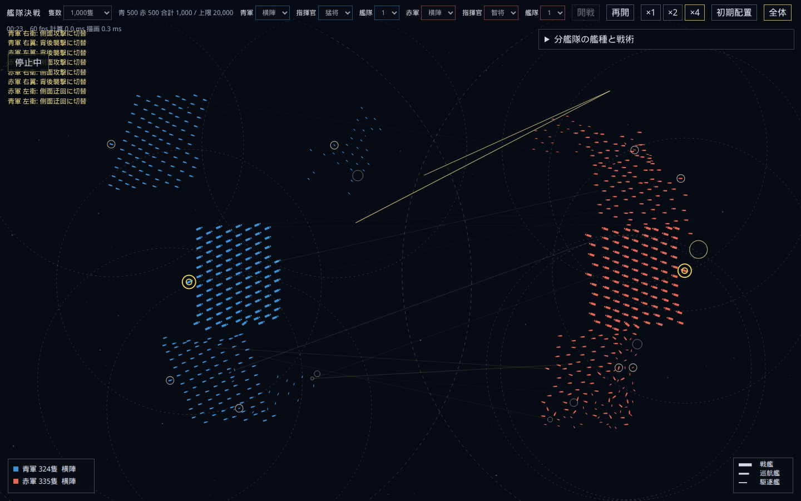
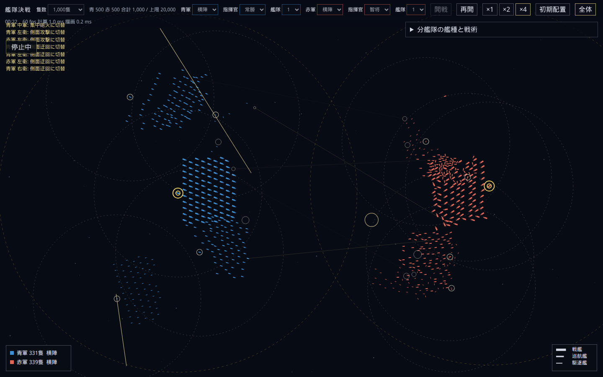
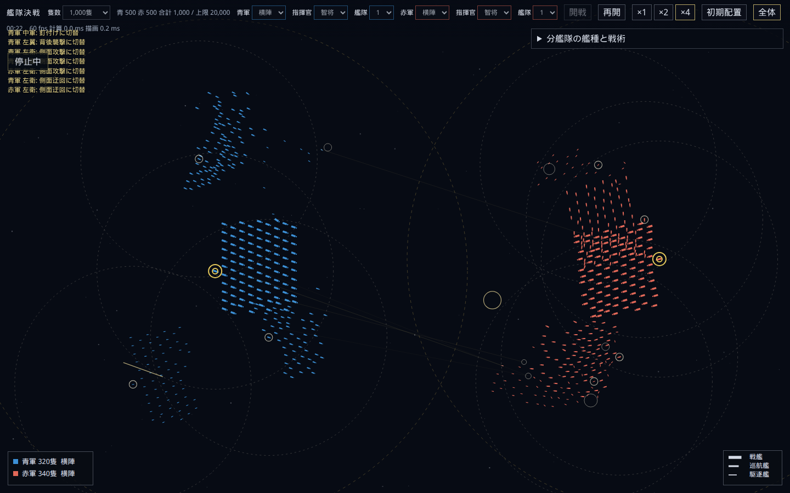
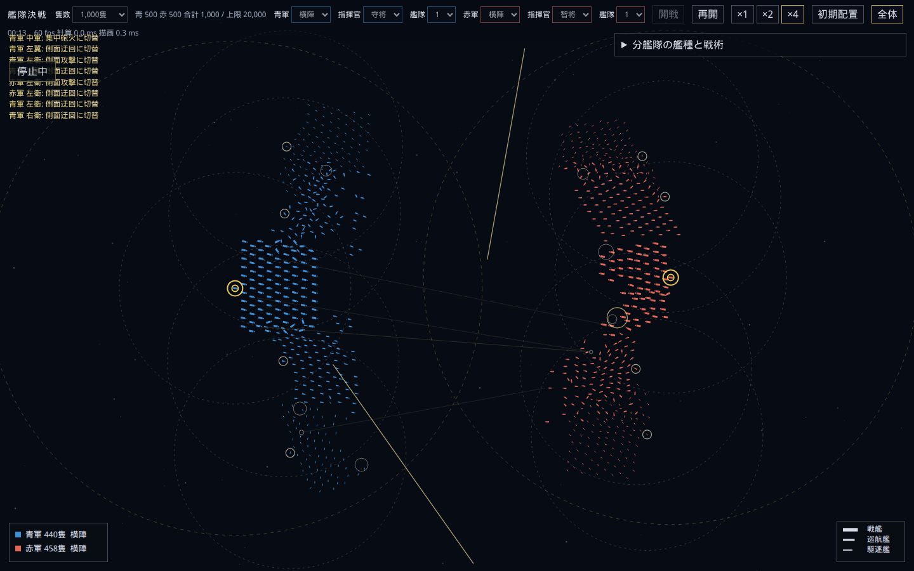
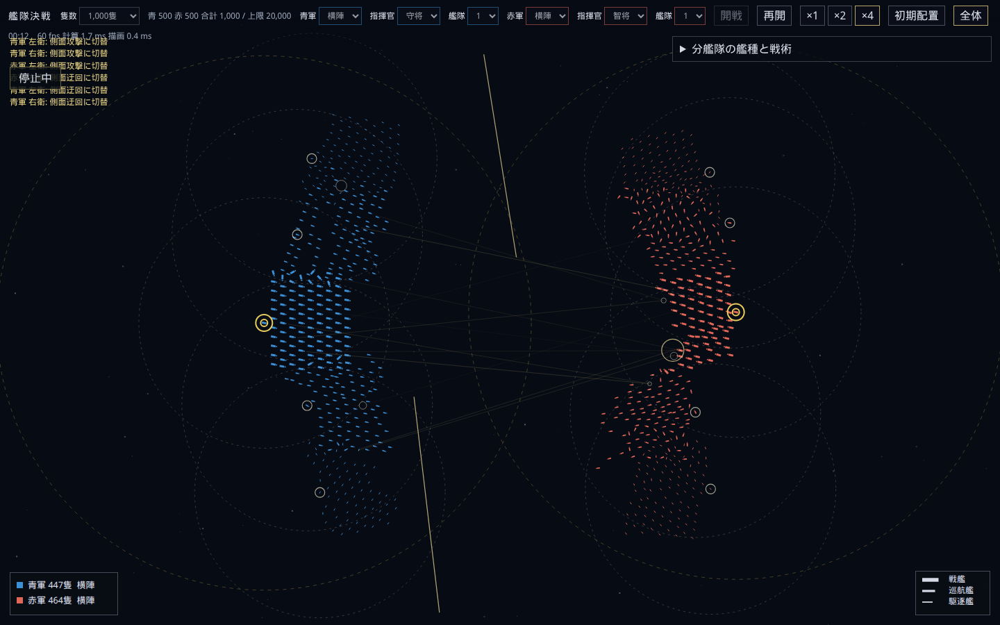
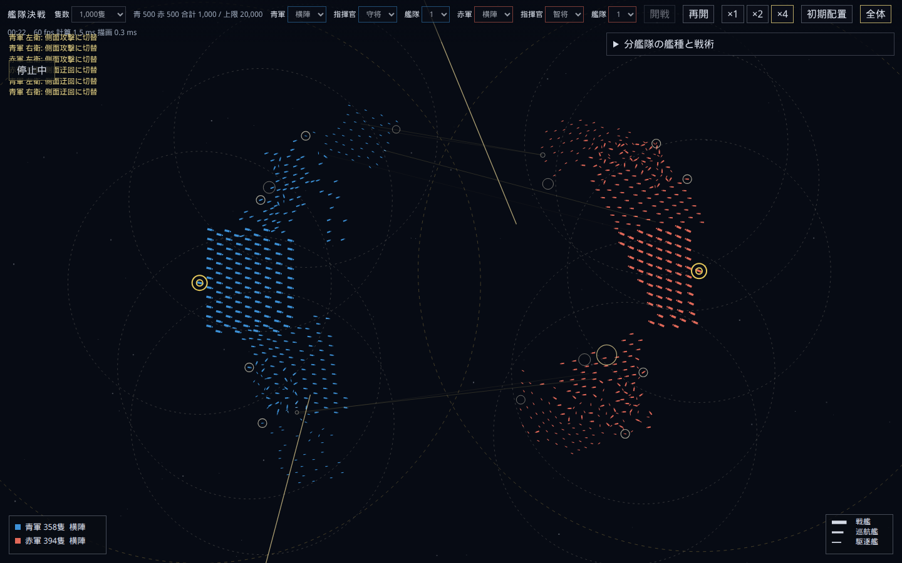

# 戦術の美しさ 第7回

第6回で、常勝の借りをやめました。常勝は 900、35 度、両翼のままです。猛将は 1,200 で 60 度の両翼、智将は薄い側の一翼 70 度、守将は 700 まで待って 25 度。四人ともこの表で固定です。

第6回の五つの案は採っていません。第5回の借りは、この決定で置き換えています。開戦 4 秒の数隻の遅れで守りに落ち、表のままの 4 勝に対して、その場の差し替えは 2 勝 2 敗、帯は 3 勝 1 敗でした。

この表に残っている弱い点は四つです。猛将は的を行き来して 4 戦中 3 敗。守将は翼が遅く、4 戦中 3 敗。四人とも列が今の約 180 より厚く、青の 30 秒の損失も今より多い。巻き上げは、一度離した隊に戻ることがある。

35 度で止めることは、常勝がすでに 35 度なので、この表の中で一度見ています。厚さは 310〜409 のままです。弧と翼の数だけの見分け、印を絞ること、数値を一つの型に束ねることは、損失を変えません。巡航艦を槌の外に置くことは未決のまま、この回の候補には入れていません。

試したのは三つです。青軍だけ新しい規則、赤軍は今の main の智将です。1,000 隻、横陣対横陣、ルール、種子 1、3、5、7、40 秒です。勝ちは 40 秒の残存です。表のままも、同じ条件で取り直しました。

| | 今の常勝 | 表の猛将 | 表の智将 | 表の守将 | 表の常勝 |
| --- | --- | --- | --- | --- | --- |
| 40 秒の勝敗 | 2 勝 1 敗 1 分 | 1 勝 3 敗 | 4 勝 | 1 勝 3 敗 | 4 勝 |
| 合図 | なし | 0 秒 | 4 秒 | 8〜9 秒 | 4 秒 |
| 押さえている隊への弾 | 的なし | 48〜51% | 46〜55% | 40〜47% | 41〜47% |
| 一つの隊に最も集まった弾 | 42〜46% | 34〜42% | 27〜32% | 40〜47% | 27〜31% |
| 赤が 80 隻失うまで | 16〜17 秒 | 14〜15 秒 | 14〜15 秒 | 19〜21 秒 | 13〜15 秒 |
| 30 秒の損失、青 | 160〜202 | 224〜272 | 204〜221 | 185〜237 | 215〜225 |
| 30 秒の損失、赤 | 165〜204 | 183〜202 | 175〜228 | 152〜173 | 193〜214 |
| 30 秒の幅×厚さ | 507〜577 × 160〜212 | 549〜666 × 234〜306 | 558〜567 × 353〜484 | 471〜540 × 235〜287 | 543〜571 × 310〜409 |
| 的の列 | なし | 7,6,9,5,6,7 と戻る | 7,6,9,5,8 | 7、または 7,6 | 7,6,9,5,8 |

守将は第5回の集計では 0 勝 3 敗 1 分でした。この回の取り直しは 1 勝 3 敗です。合図と厚さと、赤を削る遅さは同じです。

## 試した規則

### 猛将は、一度離した隊に戻らない

距離 1,200、角度 60 度、両翼、残存 45% で次へ進む、外側に回されても戻らない、ここは表のままです。変えるのは一つで、前の的を候補から外します。常勝と同じく、離した隊には戻りません。

| | 表の猛将 | 戻さない猛将 |
| --- | --- | --- |
| 40 秒の勝敗 | 1 勝 3 敗 | 3 勝 1 敗 |
| 押さえている隊への弾 | 48〜51% | 27〜40% |
| 一つの隊に最も集まった弾 | 34〜42% | 35〜47% |
| 赤が 80 隻失うまで | 14〜15 秒 | 14〜15 秒 |
| 30 秒の損失、青 / 赤 | 224〜272 / 183〜202 | 227〜284 / 186〜227 |
| 30 秒の幅×厚さ | 549〜666 × 234〜306 | 524〜638 × 176〜244 |
| 的の列 | 7,6,9,5,6,7 と戻る | 7,6,9,5,8。4 戦とも戻らない |

勝ちは 1 勝から 3 勝です。的は戻りません。押さえている隊への割合が下がるのは、そこに居座らず次へ進むためです。一つの隊に最も集まった弾は 35〜47% で、表の 34〜42% より少し高いです。厚さは 176〜244 まで下がり、表の猛将より薄いです。30 秒の青の損失は 227〜284 で、今の常勝の 160〜202 よりまだ多いです。種子 7 だけ負けました。

戻さない猛将を、表の守将と、種子 3 と 7 で当てました。どちらも青の勝ちです。的は 7,6,9,5,8 のままです。

### 槌は前へ出ず、金床と同じ深さで横へ滑る

角度は翼の横位置だけに使います。前後の位置は、金床が止まる深さのままです。60 度でも 70 度でも、翼は前へ進みません。四人ともこの規則です。距離と、片翼か両翼かと、的の選び方は表のままです。

| | 猛将 | 智将 | 守将 | 常勝 |
| --- | --- | --- | --- | --- |
| 40 秒の勝敗 | 2 勝 2 敗 | 2 勝 2 敗 | 3 勝 1 敗 | 3 勝 1 敗 |
| 合図 | 0 秒 | 4 秒 | 8〜9 秒 | 4 秒 |
| 押さえている隊への弾 | 52〜59% | 48〜59% | 41〜52% | 42〜59% |
| 一つの隊に最も集まった弾 | 30〜37% | 26〜37% | 35〜45% | 27〜39% |
| 赤が 80 隻失うまで | 13〜15 秒 | 14〜16 秒 | 20〜22 秒 | 13〜15 秒 |
| 30 秒の損失、青 | 182〜256 | 208〜240 | 180〜216 | 199〜219 |
| 30 秒の損失、赤 | 175〜242 | 186〜238 | 144〜191 | 198〜232 |
| 30 秒の幅×厚さ | 560〜615 × 213〜363 | 591〜733 × 294〜352 | 531〜565 × 190〜256 | 656〜837 × 305〜387 |
| 的の列 | 7,6,9,5,6,7 と戻る | 7,6,9,5,8 | 7、7,6、7,9,6 | 7,6,9,5,8 |

厚さは 180 に戻りません。常勝は 305〜387 で、表の 310〜409 とほぼ同じです。幅は 656〜837 まで広がりました。智将の 4 勝は 2 勝 2 敗に減ります。深い片翼が勝っていた分が、列に残すと消えます。守将は 1 勝 3 敗から 3 勝 1 敗です。30 秒の青の損失は 180〜216 で、四人のうち今の常勝に一番近いです。猛将は 2 勝 2 敗で、的はまだ戻ります。

両方をこの規則にした常勝対智将を、種子 3 と 7 だけ見ました。1 勝 1 敗です。30 秒の厚さは 166 と 185 で、今の常勝の 160〜212 まで下がりました。青だけが列に残し、赤が今の動きのままだと、厚さは 300 前後に残ります。

1 万隻でこの規則の常勝を、種子 3、30 秒だけ見ました。幅 2,216、厚さ 522、青の損失 626、赤の損失 708、青が残存で前です。合図は 13 秒、的は 7,9,6 です。ステップの時間は下に書きます。

### 守将は、900 で 25 度を出す

角度 25 度、両翼、不利なあいだは的を変えない、ここは表のままです。変えるのは距離だけで、700 を 900 にします。翼は 4 秒で出ます。

4 戦とも負けです。表の守将は 1 勝 3 敗でした。合図は 8〜9 秒から 4 秒になります。的は 4 戦とも 7 のままです。押さえている隊への弾と、最も集まった弾はどちらも 45〜53% です。赤が 80 隻失うまでは 19〜21 秒。30 秒の損失は青 199〜220、赤 145〜178。幅×厚さは 529〜569 × 219〜311 です。早く浅い翼を出すと、待ちの 1 勝もなくなります。

左上の古い戦術名は残っています。弧は槌の隊から目標までです。

1 万隻で両軍に「列に残す」を載せたステップは中央値 5.15ms です。上限は 12ms です。6 艦隊で合計 1 万隻は 4.01ms です。上限は 14ms です。6 艦隊ではこの作戦は動かしていません。

## 案

### 1. 猛将は、一度離した隊に戻らない

上の測定です。1,200 と 60 度と両翼はそのまま、離した隊だけ候補から外します。

画面は 23 秒の絵です。翼は前へ出て、艦隊は三つに分かれます。戻さないことは、弧の形には出ません。的の列が 7,6,9,5,8 で止まることに出ます。

感じは、猛将が突破した側から先へ進み、同じ隊を撃ち直さないことです。深さは、残存 45% で次へ進む境のままです。

リスクは、種子 7 のように 1 戦はまだ負けることです。30 秒の青の損失は 227〜284 で、今より多いです。今の的が消えたとき、一番近い隊を取り直す穴は残しています。この 4 戦では、その穴には落ちていません。

大きさは小さいです。猛将の戻る許可を外すだけです。計算は変わりません。

### 2. 槌は前へ出ず、金床と同じ深さで横へ滑る

上の測定です。角度は横位置だけ、前後は金床と同じです。

画面では、常勝の帯は斜めで、翼の一つが前に離れます。目標の深さを揃えても、22 秒の艦は一つの横列にはなりません。守将は 22 秒で斜めの帯のまま、翼は前へ出ていません。智将の槌は短い一隊です。

感じは、回り込みをやめて列の横幅を残すことです。深さは、横へどれだけ滑らせるかで、表の角度をそのまま使っています。

リスクは、智将の 4 勝が 2 勝 2 敗になることです。深い片翼が、この表で勝っていた理由です。常勝も 4 勝から 3 勝 1 敗です。厚さは、青だけのとき 300 前後のままです。両方がこの規則のときだけ、厚さは 166 と 185 まで下がりました。種子は二つです。

大きさは小さいです。翼の前後の計算を、金床の深さに固定するだけです。1 万隻は 5.15ms、6 艦隊は 4.01ms で、上限の内側です。

### 3. 守将は、900 で 25 度を出す

上の測定です。700 を 900 に変えるだけです。

画面の 12 秒は、表の 13 秒と同じ縦の列に見えます。25 度は、この距離では弧として読めません。

感じは、守将の遅れだけを縮めることです。深さは、900 という距離です。

リスクは、測定どおり 4 戦とも負けることです。早く出しても的は 7 のまま、赤の 30 秒の損失は 145〜178 で、表の守将の 152〜173 とあまり変わりません。待ちを縮めるだけでは、3 敗は直りません。

大きさは小さいです。守将の距離を一つ変えるだけです。計算は変わりません。

### 4. 次の的は隣の隊だけ。閉じた隊は、消えても開かない

的が残存の割合を切ったら、その隊を閉じます。次は、敵の列でその隣です。両隣が閉じていたら、その先の隣へ進みます。一番近い隊へは飛びません。今の的が消えても、閉じた隊は候補に戻しません。

猛将の表は 7,6,9,5 のあと 6 と 7 に戻ります。戻さない規則は 6 の次に 9 を選ぶので、隣かどうかは見ていません。この案は、その飛びを止めます。守将が不利なあいだ的を変えない規則は、そのままで、動き出すときも隣だけです。

画面では、翼が敵の列に沿って一方向へずれます。行ったり来たりしません。

感じは、端から順に畳む手順です。深さは、最初にどちら側の隣を端と決めるかです。

リスクは、隣がまだ健在だと、遠い薄い隊を無視してそこに留まることです。この案はまだ対戦していません。戻さない猛将の 3 勝は、隣ではなく一番近い隊へ進んだ結果です。

大きさは中くらいです。隊は五つなので、隣の判定は小さいです。計算は増えません。

### 5. 1 万隻では、角度を半分にする

100 隻と 1,000 隻は表の角度のままです。1 万隻では半分にします。猛将 30 度、智将 35 度、守将 12 度、常勝 18 度です。距離と、片翼か両翼かは変えません。

画面では、小さい戦いの四人の差はそのまま、大きい戦いでは四人とも横列に近くなります。

感じは、艦が多いほど列の形を優先することです。深さは、半分にする境を 1,000 のままにするか、5,000 からかけ始めるかです。

リスクは、1 万隻で四人の見た目が似ることです。この角度ではまだ対戦していません。1 万隻で見たのは、案 2 のステップ 5.15ms と、種子 1 つの 30 秒です。あの 30 秒の厚さ 522 は、半分の角度ではなく、前へ出ない規則の結果です。

大きさは小さいです。角度に、1 万隻のとき 2 分の 1 をかけるだけです。計算は変わりません。

## 比べると

| 案 | 変えること | 試作 |
| --- | --- | --- |
| 1. 猛将は戻らない | 離した隊を候補から外す | 1 勝 3 敗が 3 勝 1 敗。的は 7,6,9,5,8 |
| 2. 槌は前へ出ない | 前後は金床と同じ深さ | 智将は 4 勝から 2 勝。守将は 3 勝。厚さは 180 に戻らない |
| 3. 守将は 900 で出す | 700 を 900 にする | 0 勝 4 敗 |
| 4. 隣だけへ進む | 飛びと、消えたあとの戻りを止める | まだ |
| 5. 1 万隻は半分の角度 | 100 と 1,000 は表のまま | まだ。ステップは案 2 で 5.15ms |

35 度で止めること、巡航艦を槌の外に置くこと、印を弧に絞ること、弧と翼の数だけの見分け、数値を一つの型に束ねることは、未決のままです。

次は、この五つのうち一つを選んでください。
