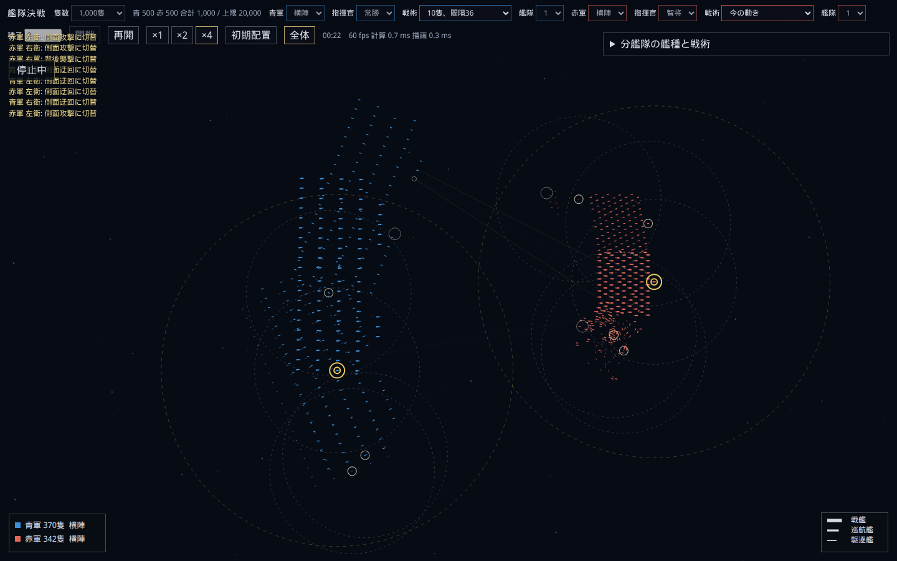
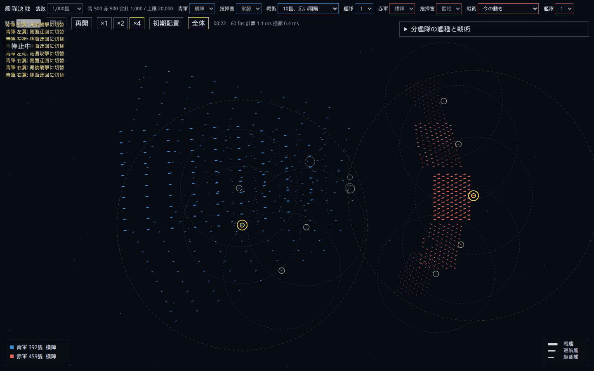

# 戦術の美しさ 第8回

第7回で採ったのは、槌を列に残すことです。公開中の画面で案を動かし、b を選びました。猛将が的に戻らないこと、守将が 900 で出すことは採っていません。

画面の「金床」「槌」と弧は消します。見て知りたいものではないので、役割の印は出しません。

遊んでみたあとの感想は、味方の艦が詰まりすぎることと、艦が一人ずつ戦うので美しさがないことです。艦隊の最小の塊を、横並び 10 隻にします。その列が動き、向き、的をそろえます。列と列のあいだにも間隔を置きます。槌を列に残す動きは、この 10 隻の上に載せます。五つの隊はそのままです。隊の中を、10 隻の横隊に分けます。

何も選ばないときの動きは、槌を列に残す方です。以前の動きは、戦術の「以前の動き」で比べられます。

試したのは四つです。青は常勝でその案、赤は今の智将です。1,000 隻、横陣、ルール、種子 1、3、5、7、40 秒です。勝ちは残存が多い方です。近い艦は、一番近い味方までの距離です。20 未満は、船体が触れ合う 14 より少し広いだけです。

| | 今の常勝 | 槌を列に残す | 間隔 36 | 広い間隔 | 欠けたら合流 | 同じ的 |
| --- | --- | --- | --- | --- | --- | --- |
| 40 秒の勝敗 | 2 勝 1 敗 1 分 | 3 勝 1 敗 | 4 勝 | 1 勝 3 敗 | 3 勝 1 分 | 4 勝 |
| 40 秒の損失、青 | 211〜265 | 224〜270 | 166〜190 | 127〜144 | 158〜246 | 137〜145 |
| 40 秒の損失、赤 | 227〜272 | 258〜302 | 226〜244 | 121〜132 | 211〜246 | 216〜228 |
| 30 秒の近い艦、中央値 | 16〜20 | 20〜21 | 28〜30 | 33〜54 | 28〜29 | 27〜29 |
| 30 秒、20 未満の艦 | 50〜70% | 39〜49% | 30〜34% | 11〜25% | 34〜36% | 31〜35% |
| 30 秒の幅×厚さ | 507〜577 × 160〜212 | 656〜837 × 305〜387 | 1,082〜1,114 × 324〜355 | 861〜924 × 769〜818 | 1,081〜1,116 × 324〜348 | 1,349〜1,372 × 426〜434 |

間隔 36 と、同じ的は、4 戦とも勝っています。30 秒の青の損失は、今の 160〜202 より少ないです。同じ的は 133〜136 まで下がります。広い間隔は艦が離れ、20 未満は 11% まで減りますが、厚さは 800 近くなり、赤をほとんど削れず 3 敗です。欠けたら合流は、間隔 36 と見た目が近く、1 戦が分けです。

1 万隻で青に間隔 36、赤に同じ的を載せたステップは 7.8ms です。上限は 12ms です。何も選ばない横陣の 1 万隻は 5.21ms、以前の動きは 5.3ms です。テストにある別の陣形の 1 万隻は 4.16ms です。6 艦隊で合計 1 万隻は 3.89ms です。上限は 14ms です。6 艦隊ではこの上書きは動きません。

## 案

### 1. 10 隻、艦の間隔 36、列の間隔 72

隊の中を、横に 2 本まで並ぶ横隊にします。1 本は 10 隻です。艦と艦は 36、列と列は 72 離れます。艦が減ると、その列だけが短くなり、中央に寄ります。隣の列とは合流しません。向きと的は、槌を列に残すときと同じで、隊がそろえます。

画面は上の 1 枚目です。赤の塊に対して、青は線が分かれています。22 秒では、まだ完全な横一列には見えず、縦に伸びた線が何本もあります。

感じは、隊の中に小さな横隊が見えることです。深さは、36 と 72 です。

リスクは、測定では 4 勝ですが、厚さは今の 180 前後から 330 前後に増えることです。20 未満の艦も 30% 残っています。

大きさは中くらいです。席を毎秒置き直し、艦をその席へ寄せます。1 万隻は 7.8ms で、上限の内側です。

### 2. 10 隻、艦の間隔 56、列の間隔 120

横には 1 本だけです。間隔を広くして、詰まりを優先して消します。欠け方は案 1 と同じで、列が短くなります。

画面は 2 枚目です。艦が散って、艦隊の形が読めません。

感じは、水を大きく取ることです。深さは、56 と 120 です。

リスクは、4 戦中 3 敗です。40 秒で赤が失うのは 121〜132 隻だけで、撃ち合いになりません。厚さは 770〜820 です。

大きさは案 1 と同じです。数字が広いだけです。

### 3. 5 隻を切った列は、隣の列に入る

間隔は案 1 と同じです。生きている艦が 5 を切ったら、空席のある一番近い列へ移します。移ったあとも 1 本は 10 隻までです。

画面は案 1 とほとんど同じに見えます。22 秒では、まだ多くの列が 5 隻を上回っているためです。

感じは、途中から短い列が残らないことです。深さは、5 隻という境です。

リスクは、案 1 の 4 勝が 3 勝 1 分になることです。種子 7 は 246 同士で分けでした。30 秒の近さは案 1 とほぼ同じです。

大きさは案 1 に、列の人数を数える処理を足しただけです。

### 4. 横に 3 本。一つの列は同じ敵艦を狙う

艦の間隔は 40、列の間隔は 84、横に 3 本までです。欠けた列は短くなるだけで、合流しません。列の 10 隻は、隊が押さえている敵の隊の中で、いちばん近い艦を同じ的にします。

画面では、線が案 1 より横に広がります。幅は 1,350 前後です。

感じは、10 隻が一つの銃になることです。深さは、3 本という横幅と、40 と 84 です。

リスクは、幅が広がるので、画面では一つの帯より扇に見えることです。勝敗は 4 勝で、40 秒の青の損失は四つで一番少ない 137〜145 です。

大きさは案 1 に、列ごとの的を足しています。1 万隻でも 7.8ms に収まります。

## 比べると

| 案 | 変えること | 試作 |
| --- | --- | --- |
| 1. 間隔 36 | 2 本、欠けたらその列が短くなる | 4 勝。近い艦 28〜30 |
| 2. 広い間隔 | 1 本、56 と 120 | 1 勝 3 敗。艦は離れるが、戦いが遅い |
| 3. 欠けたら合流 | 5 隻未満は隣へ | 3 勝 1 分。見た目は案 1 に近い |
| 4. 同じ的 | 3 本、列で一つの敵艦 | 4 勝。青の損失が一番少ない |

次は、この四つのうち一つを選んでください。槌を列に残す動きは、何も選んでいないときの動きにしてあります。
